# Automated Threat Modeling CLI using LLMs
## Phase 2 — Design Document Ingestion and Context Fusion

> **Author:** Mohammed Farhan · **Version:** 1.0 · **Date:** March 2026 · **Status:** Draft  
> **Builds on:** Phase 1 (Project Skeleton, IaC Parser, Prompt Templates, LLM Client)  
> **Timeline:** Weeks 5–7 (March–April)

---

## Table of Contents

1. [Phase 2 Overview](#1-phase-2-overview)
2. [What Changes in Phase 2](#2-what-changes-in-phase-2)
3. [Document Parser — Deep Design](#3-document-parser--deep-design)
4. [Context Fusion — Deep Design](#4-context-fusion--deep-design)
5. [Discrepancy Detection Model](#5-discrepancy-detection-model)
6. [Multi-Source Prompt Template Design](#6-multi-source-prompt-template-design)
7. [Phase 2 Tasks](#7-phase-2-tasks)
8. [Phase 2 Task Summary](#8-phase-2-task-summary)
9. [Evaluation Hooks for RQ1](#9-evaluation-hooks-for-rq1)
10. [Technical Risks and Mitigations](#10-technical-risks-and-mitigations)

---

## 1. Phase 2 Overview

Phase 1 established a working IaC-only pipeline: Terraform files are parsed, summarised, and analysed by an LLM to produce STRIDE threats. Phase 2 extends this with the second and most research-critical input channel — **Design Documents** — and introduces the **Context Fusion** mechanism that compares design intent against implementation reality.

This is the phase that directly addresses **Research Question 1** (Can LLMs effectively correlate unstructured design documents with structured IaC to identify discrepancies?) and lays the groundwork for **Research Question 2** (Does multi-source input produce more precise threat models than IaC alone?).

### Phase Objectives

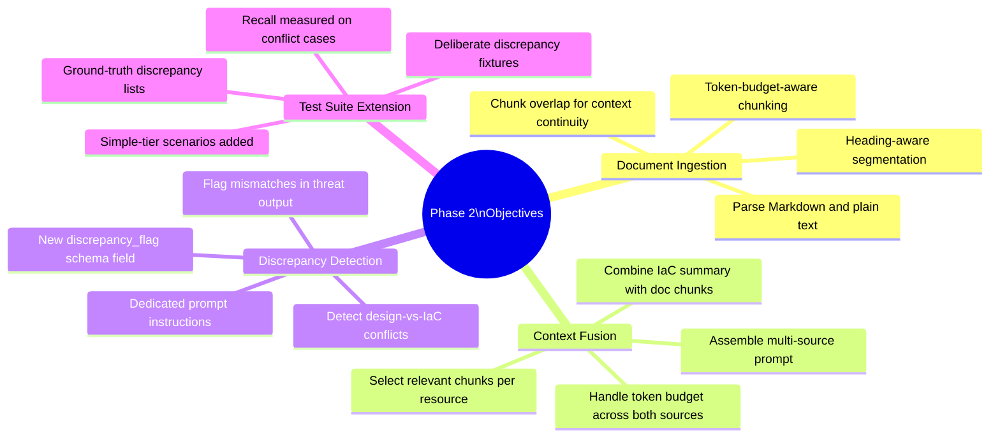

### How Phase 2 Fits into the Overall Pipeline

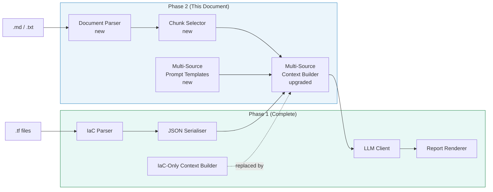

---

## 2. What Changes in Phase 2

The Phase 1 pipeline treated the Context Builder as a single-input module that only consumed the IaC resource map. Phase 2 upgrades three components and introduces two new ones.

### Component Change Summary

| Component | Phase 1 State | Phase 2 Change |
|-----------|--------------|----------------|
| `doc_parser.py` | Stub / not implemented | **New** — full heading-aware chunker with overlap |
| `context_builder.py` | IaC-only, single prompt template | **Upgraded** — multi-source, chunk selection, dual templates |
| `prompts/system_multisource.txt` | Empty placeholder | **New** — discrepancy-aware prompt template |
| `cli.py` | `--doc` flag accepted but ignored | **Activated** — `--doc` now triggers multi-source path |
| `tests/fixtures/` | 5 trivial IaC-only scenarios | **Extended** — simple-tier scenarios with design docs + discrepancies |

### Pipeline Branching Logic

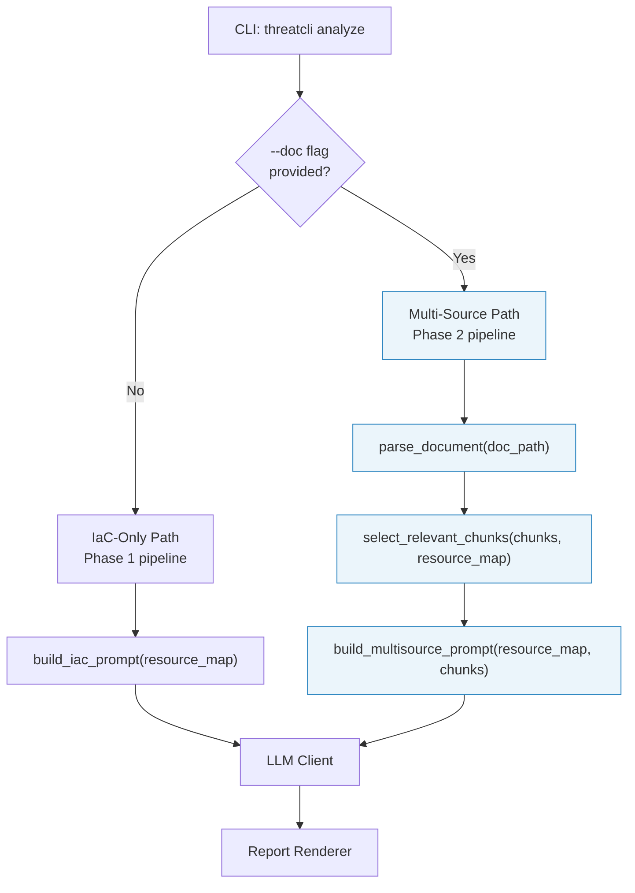

---

## 3. Document Parser — Deep Design

The Document Parser (`doc_parser.py`) is a new module introduced in Phase 2. Its job is to transform a free-form design document into a structured list of **chunks** that the Context Builder can selectively inject into the LLM prompt.

### 3.1 Parsing Strategy

Design documents vary widely in structure — from tightly structured Markdown with headings to flowing prose. The parser must handle both.

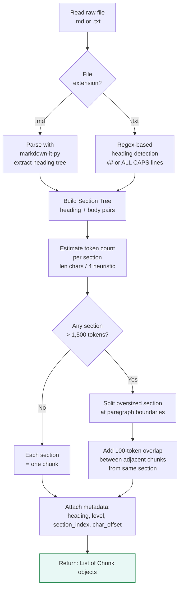

### 3.2 Chunk Data Structure

Each chunk is a structured object that carries enough metadata for the Context Builder to make selection decisions.

```python
@dataclass
class DocumentChunk:
    chunk_id:      str    # e.g. "chunk_003"
    heading:       str    # Nearest ancestor heading text
    heading_level: int    # 1 = h1, 2 = h2, etc. (0 = no heading)
    text:          str    # Chunk body text (may include overlap)
    section_index: int    # Position in document (for ordering)
    token_estimate: int   # Approximate token count
    has_overlap:   bool   # True if this chunk includes overlap from adjacent chunk
```

### 3.3 Token Estimation

Token counting without importing a full tokeniser (to avoid heavy dependencies):

```
token_estimate = len(text) // 4
```

This is a character-based heuristic. It overestimates for code/JSON and underestimates for CJK text, but is accurate to within 10–15% for typical English design documents, which is sufficient for budget planning.

### 3.4 Chunking Parameters

| Parameter | Default | Env var override | Description |
|-----------|---------|-----------------|-------------|
| `MAX_CHUNK_TOKENS` | 1,500 | `TM_MAX_CHUNK_TOKENS` | Maximum tokens per chunk before splitting |
| `OVERLAP_TOKENS` | 100 | `TM_OVERLAP_TOKENS` | Tokens of overlap between adjacent chunks |
| `MIN_CHUNK_TOKENS` | 50 | — | Chunks smaller than this are merged with the next |

### 3.5 Edge Cases

| Edge Case | Handling |
|-----------|---------|
| Document with no headings | Entire document treated as one section; split by paragraphs if over limit |
| Empty document | Return empty list; log warning; pipeline continues with IaC-only path |
| Non-UTF-8 encoding | Attempt UTF-8 with `errors='replace'`; log a warning per replaced character |
| Document > 20,000 tokens total | Warn user; only the first 15,000 tokens are processed (configurable via `TM_MAX_DOC_TOKENS`) |
| Single paragraph longer than max chunk | Split at sentence boundaries using a simple period-space heuristic |

---

## 4. Context Fusion — Deep Design

Context Fusion is the process of combining the IaC resource map and the design document chunks into a single, coherent LLM prompt. It is the core research contribution of this project.

### 4.1 The Fusion Problem

A naive approach — simply concatenating all chunks and the full resource map — fails for three reasons:

1. **Token limits:** A realistic design doc (5–10 pages) + a moderate Terraform codebase can easily exceed 8,000 tokens, which strains both cost and context window quality.
2. **Relevance noise:** Unrelated design sections (e.g. a UI style guide) add noise that degrades threat detection precision.
3. **Positional bias:** LLMs attend more reliably to content at the beginning and end of a prompt; burying the most relevant chunks in the middle reduces effectiveness.

### 4.2 Chunk Selection Strategy

The Chunk Selector scores each document chunk against the IaC resource map and selects the highest-scoring chunks up to a token budget.

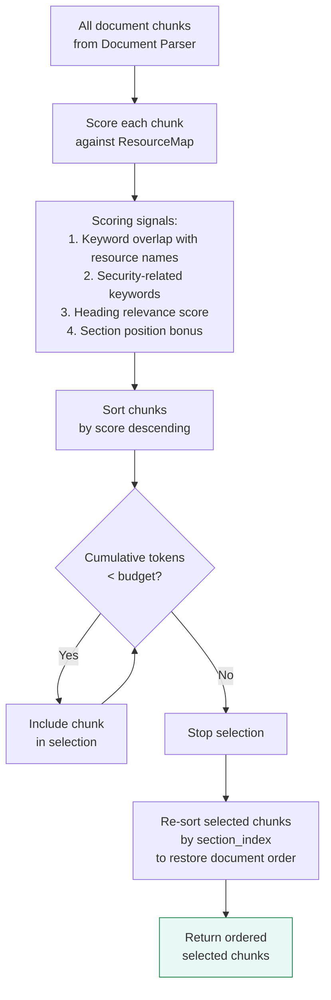

### 4.3 Scoring Function

Each chunk receives a relevance score computed from four signals:

```
score(chunk) = w1 * keyword_overlap(chunk, resource_names)
             + w2 * security_keyword_density(chunk)
             + w3 * heading_relevance(chunk.heading)
             + w4 * position_bonus(chunk.section_index)
```

| Signal | Weight | Description |
|--------|--------|-------------|
| `keyword_overlap` | 0.40 | Fraction of Terraform resource names appearing in chunk text (case-insensitive) |
| `security_keyword_density` | 0.30 | Count of security-related terms (auth, encrypt, access, role, policy, secret, token, permission, port, expose, public, private) divided by chunk length |
| `heading_relevance` | 0.20 | Binary: 1.0 if heading contains security/architecture keywords, 0.3 otherwise |
| `position_bonus` | 0.10 | Slight preference for early sections (executive summary, overview) — score = 1 - (section_index / total_sections) |

> **Weights are configurable** via a `chunk_selection_weights` config key and will be tuned during evaluation.

### 4.4 Token Budget Allocation

The total prompt token budget is split across three regions:

```
+--------------------------------------------------+
|  System Instruction        ~500 tokens (fixed)   |
+--------------------------------------------------+
|  IaC Resource Summary      up to 2,000 tokens    |
+--------------------------------------------------+
|  Design Document Chunks    up to 2,500 tokens    |
+--------------------------------------------------+
|  Task Instruction          ~300 tokens (fixed)   |
+--------------------------------------------------+
|  TOTAL                     ~5,300 tokens         |
+--------------------------------------------------+
```

If the IaC summary exceeds 2,000 tokens, the document chunk budget is reduced proportionally (minimum 500 tokens reserved for document context). If both inputs are very large, the system logs a `TokenBudgetExceededWarning` and proceeds with truncated inputs.

### 4.5 Assembled Prompt Structure

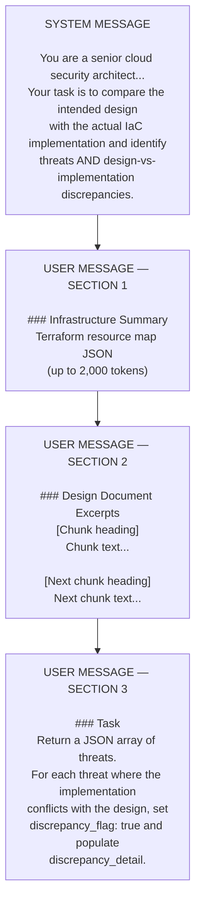

---

## 5. Discrepancy Detection Model

Discrepancy detection — identifying conflicts between what the design document *says* and what the Terraform code *does* — is the most novel capability introduced in Phase 2. It directly answers Research Question 1.

### 5.1 Categories of Discrepancy

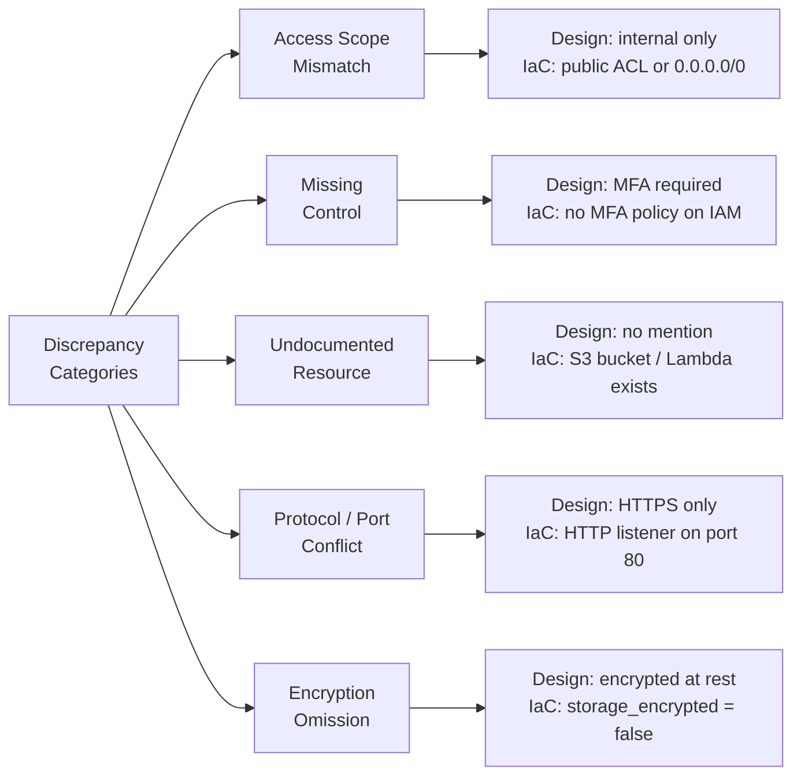

### 5.2 Discrepancy Examples for Test Fixtures

| Discrepancy ID | Design Doc States | Terraform Does | Category |
|---------------|------------------|---------------|---------|
| `DISC-01` | "All data storage is internal-only" | `aws_s3_bucket` with `acl = "public-read"` | Access Scope Mismatch |
| `DISC-02` | "API is HTTPS-only" | `aws_lb_listener` with `protocol = "HTTP"` on port 80 | Protocol/Port Conflict |
| `DISC-03` | "Database must not be publicly accessible" | `aws_db_instance` with `publicly_accessible = true` | Access Scope Mismatch |
| `DISC-04` | "All secrets managed via Vault" | `aws_lambda_function` with plaintext env vars for secrets | Missing Control |
| `DISC-05` | "EBS volumes encrypted at rest" | `aws_ebs_volume` with `encrypted = false` | Encryption Omission |

### 5.3 Discrepancy in the Threat Schema

Threats flagged as discrepancies populate two additional fields in the output schema:

```json
{
  "threat_id":          "T-003",
  "stride_category":    "Information Disclosure",
  "component":          "aws_s3_bucket.assets",
  "description":        "S3 bucket is publicly readable, contradicting the design requirement for internal-only storage.",
  "discrepancy_flag":   true,
  "discrepancy_detail": "Design document (Section 3.2: Storage) states 'all data storage is internal-only'. The Terraform resource aws_s3_bucket.assets has acl = public-read.",
  "severity":           "High",
  "references":         [
    "aws_s3_bucket.assets.acl = \"public-read\"",
    "Design doc Section 3.2: 'all data storage is internal-only'"
  ]
}
```

---

## 6. Multi-Source Prompt Template Design

Phase 2 introduces a second prompt template (`system_multisource.txt`) specifically designed to elicit discrepancy detection from the LLM. It builds on the IaC-only template from Phase 1 with three critical additions.

### 6.1 Additions Over the IaC-Only Template

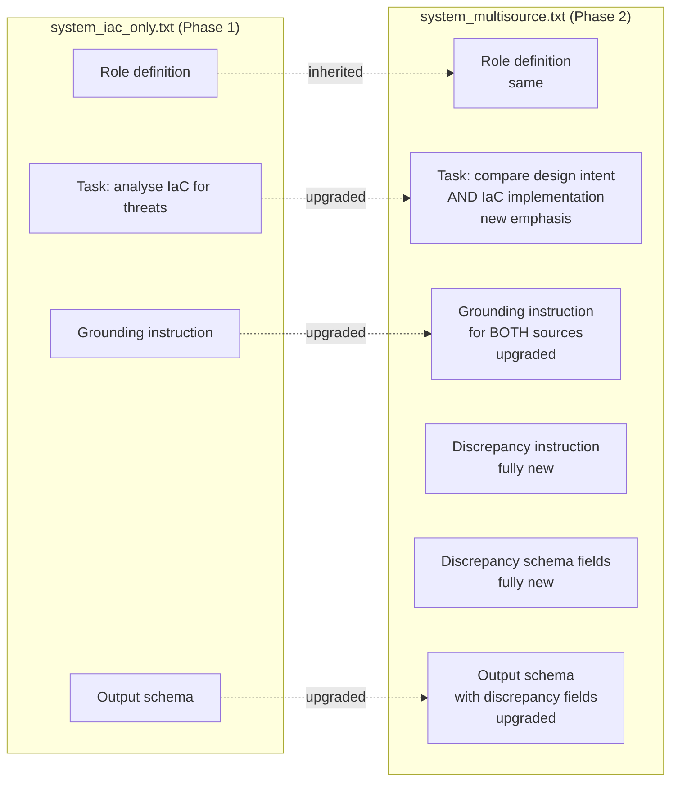

### 6.2 New Prompt Sections

**Discrepancy Instruction (new in Phase 2):**

```
### Discrepancy Detection

After identifying all STRIDE threats, review the Infrastructure Summary
and Design Document Excerpts together and identify any cases where:

  - The design document describes a security control or access restriction
    that is NOT present in the Terraform code, or
  - The Terraform code exposes or configures something in a way that
    contradicts the design document.

For each such conflict:
  - Set discrepancy_flag to true
  - Populate discrepancy_detail with a specific description that quotes
    the relevant design document phrase AND the specific Terraform
    resource attribute that contradicts it.
  - Reference both the IaC line AND the design document section in the
    references array.

Important: Only flag a discrepancy when there is clear, specific evidence
in both inputs. Do not infer discrepancies from absence of information.
```

### 6.3 Template Versioning

Both prompt templates are versioned files. Changes are recorded in `prompts/CHANGELOG.md`.

| Version | Template | Change |
|---------|----------|--------|
| `v1.0` | `system_iac_only.txt` | Initial IaC-only template (Phase 1) |
| `v2.0` | `system_multisource.txt` | Multi-source template with discrepancy detection (Phase 2) |
| `v2.1` | `system_multisource.txt` | (Reserved for prompt iteration during evaluation) |

---

## 7. Phase 2 Tasks

> **Timeline:** Weeks 5–7 (March–April) · **Goal:** Implement the Document Parser, upgrade the Context Builder for multi-source input, introduce discrepancy detection, and extend the test suite with simple-tier scenarios and discrepancy fixtures.

```mermaid
gantt
    title Phase 2 Task Schedule (3 Weeks)
    dateFormat  DD
    axisFormat  Day %d

    section Document Parser
    P2-T01 Chunk Data Structure and Token Estimator  :t01, 01, 2d
    P2-T02 Heading-Aware Document Segmentation       :t02, after t01, 3d
    P2-T03 Paragraph-Level Split and Overlap Logic   :t03, after t02, 2d

    section Context Fusion
    P2-T04 Chunk Scoring and Selection               :t04, after t03, 2d
    P2-T05 Token Budget Allocator                    :t05, after t04, 1d
    P2-T06 Multi-Source Context Builder              :t06, after t05, 2d

    section Prompts
    P2-T07 Multi-Source Prompt Template              :t07, after t06, 2d

    section Testing
    P2-T08 Simple-Tier Test Fixtures                 :t08, after t07, 3d
    P2-T09 Discrepancy Detection Integration Tests   :t09, after t08, 2d
    P2-T10 CLI Activation and End-to-End Smoke Test  :t10, after t09, 1d
```

---

### Task P2-T01 — Chunk Data Structure and Token Estimator

| Attribute | Detail |
|-----------|--------|
| **Task ID** | P2-T01 |
| **Estimate** | 2–3 hours |
| **Status** | To Do |
| **Depends On** | P1-T01 (project skeleton) |

**Description:** Define the `DocumentChunk` dataclass and implement the token estimation utility function that all subsequent parser and selector logic will rely on. This is a small but load-bearing task — getting the data contract right before building the parser avoids costly refactors.

**Acceptance Criteria:**
- [ ] `DocumentChunk` dataclass defined in `threatcli/parsers/doc_parser.py` with fields: `chunk_id`, `heading`, `heading_level`, `text`, `section_index`, `token_estimate`, `has_overlap`
- [ ] `estimate_tokens(text: str) -> int` utility function implemented using the `len(text) // 4` heuristic
- [ ] `chunk_id` is auto-generated as a zero-padded string (e.g. `"chunk_003"`) based on insertion order
- [ ] `DocumentChunk` is JSON-serialisable (for debugging and test fixtures)
- [ ] Unit tests cover: token estimate for a known string, dataclass field defaults, JSON serialisation round-trip

---

### Task P2-T02 — Heading-Aware Document Segmentation

| Attribute | Detail |
|-----------|--------|
| **Task ID** | P2-T02 |
| **Estimate** | 4–5 hours |
| **Status** | To Do |
| **Depends On** | P2-T01 |

**Description:** Implement the core document segmentation logic that splits a Markdown or plain-text file into sections based on headings. This produces the initial (pre-chunking) section list that is then refined in P2-T03.

**Acceptance Criteria:**
- [ ] `segment_document(file_path: str) -> List[DocumentChunk]` parses `.md` files using `markdown-it-py` and `.txt` files using a regex-based heading detector
- [ ] Each heading (h1–h4 in Markdown; `##`-prefixed or ALL-CAPS lines in plain text) creates a new section boundary
- [ ] The heading text and level are correctly extracted and stored in each `DocumentChunk`
- [ ] Sections with no heading (text before the first heading) are assigned `heading = "[Preamble]"` and `heading_level = 0`
- [ ] Documents with no headings at all are returned as a single chunk covering the entire document
- [ ] Unit tests cover: multi-heading Markdown file, plain text with `##` headings, file with no headings, empty file (returns empty list)

**Test Document Scenarios:**

| Scenario | Input | Expected Output |
|----------|-------|----------------|
| `seg_md_basic` | Markdown with 3 h2 headings | 3 chunks, correct heading text and levels |
| `seg_md_nested` | Markdown with h2 + h3 sub-sections | Chunks with mixed heading levels |
| `seg_txt_hash` | Plain text with `## Section` prefixes | 3+ chunks with correct headings |
| `seg_no_headings` | Prose-only plain text | 1 chunk, heading = "[Preamble]", level = 0 |
| `seg_empty` | Empty file | Empty list returned, no exception |

---

### Task P2-T03 — Paragraph-Level Split and Overlap Logic

| Attribute | Detail |
|-----------|--------|
| **Task ID** | P2-T03 |
| **Estimate** | 3–4 hours |
| **Status** | To Do |
| **Depends On** | P2-T02 |

**Description:** Extend the segmentation output from P2-T02 to enforce the 1,500-token maximum per chunk. Sections that exceed the limit are split at paragraph boundaries, and 100-token overlap is added between adjacent sub-chunks from the same section.

**Acceptance Criteria:**
- [ ] `chunk_sections(sections: List[DocumentChunk], max_tokens: int = 1500, overlap_tokens: int = 100) -> List[DocumentChunk]` takes the flat section list and returns a refined chunk list
- [ ] No chunk in the output exceeds `max_tokens` (verified by `estimate_tokens`)
- [ ] Chunks that result from splitting a single section have `has_overlap = True` and include the last `overlap_tokens` worth of text from the previous chunk prepended
- [ ] Chunks smaller than 50 tokens are merged with the following chunk (unless it is from a different heading)
- [ ] The `section_index` on output chunks preserves relative document order
- [ ] Unit tests cover: section under limit (no split), section exactly at limit (no split), section 1.5x the limit (splits into 2), very long single paragraph, tiny sections that merge

**Chunking Behaviour Illustration:**

```
Section A (800 tokens)   ---> [Chunk A1: 800 tokens]       has_overlap = False

Section B (3,200 tokens) ---> [Chunk B1: 1,500 tokens]     has_overlap = False
                               [Chunk B2: 1,500 + 100 overlap] has_overlap = True
                               [Chunk B3: 200 + 100 overlap]   has_overlap = True

Section C (40 tokens)    ---> merged into Chunk B3 (same heading level)
```

---

### Task P2-T04 — Chunk Scoring and Selection

| Attribute | Detail |
|-----------|--------|
| **Task ID** | P2-T04 |
| **Estimate** | 4–5 hours |
| **Status** | To Do |
| **Depends On** | P2-T03, P1-T02 (IaC Parser, for ResourceMap) |

**Description:** Implement the Chunk Selector that scores each document chunk against the IaC ResourceMap and returns an ordered selection that fits within the document token budget. This is the key intelligence mechanism enabling context-aware fusion.

**Acceptance Criteria:**
- [ ] `score_chunk(chunk: DocumentChunk, resource_map: dict) -> float` returns a normalised score in [0.0, 1.0] using the four-signal weighted formula
- [ ] `select_chunks(chunks: List[DocumentChunk], resource_map: dict, token_budget: int = 2500) -> List[DocumentChunk]` returns chunks sorted by `section_index` (document order), not score, so the LLM receives context in a coherent narrative order
- [ ] The scoring weights (`w1`–`w4`) are configurable via a dict parameter with defaults `{0.40, 0.30, 0.20, 0.10}`
- [ ] Security keyword list is stored as a module-level constant and is easily extensible
- [ ] If no chunks score above 0.05, all chunks are included up to the token budget (fallback: prefer some context over none)
- [ ] Unit tests cover: chunk with exact resource name match scores highest, chunk with only security keywords scores mid-range, irrelevant chunk scores lowest, token budget respected

**Scoring Signal Implementation:**

```python
SECURITY_KEYWORDS = [
    "auth", "encrypt", "access", "role", "policy", "secret", "token",
    "permission", "port", "expose", "public", "private", "firewall",
    "certificate", "tls", "ssl", "https", "mfa", "iam", "rbac",
    "least privilege", "zero trust", "network", "ingress", "egress"
]

SECURITY_HEADING_KEYWORDS = [
    "security", "auth", "access", "network", "architecture",
    "infrastructure", "data", "storage", "api", "service"
]
```

---

### Task P2-T05 — Token Budget Allocator

| Attribute | Detail |
|-----------|--------|
| **Task ID** | P2-T05 |
| **Estimate** | 2–3 hours |
| **Status** | To Do |
| **Depends On** | P2-T04, P1-T03 (JSON Serialiser) |

**Description:** Implement the Token Budget Allocator that determines how many tokens to allocate to the IaC summary and the document chunks given the total prompt budget. This logic lives in the Context Builder and is extracted as a separate, testable function.

**Acceptance Criteria:**
- [ ] `allocate_token_budget(iac_tokens: int, doc_tokens: int, total_budget: int = 5300) -> Tuple[int, int]` returns `(iac_budget, doc_budget)` respecting the constraints below
- [ ] Fixed overhead (system instruction + task instruction) of 800 tokens is always reserved
- [ ] Remaining budget is split: IaC gets 45%, document gets 55% by default
- [ ] Neither budget falls below its minimum floor: IaC minimum 800 tokens, document minimum 500 tokens
- [ ] If total available (after overhead) is less than 1,300 tokens (sum of floors), raises `InsufficientBudgetError`
- [ ] Unit tests verify: balanced inputs, IaC-heavy input, document-heavy input, and the floor clipping behaviour

**Budget Allocation Logic:**

```mermaid
flowchart TD
    A["Total budget: 5,300 tokens"] --> B["Reserve fixed overhead: 800 tokens\nRemaining: 4,500 tokens"]
    B --> C{IaC tokens\n> 2,025 (45%)?}
    C -->|Yes| D["Clip IaC to 2,025\nGive remainder to doc\nup to 2,475"]
    C -->|No| E["IaC gets what it needs\nDoc gets the rest\nup to 2,475"]
    D --> F{Doc budget\n< 500 minimum?}
    E --> F
    F -->|Yes| G["Raise InsufficientBudgetError"]
    F -->|No| H["Return (iac_budget, doc_budget)"]

    style G fill:#FDEDEC,stroke:#C0392B
    style H fill:#E8F8F5,stroke:#1E8449
```

---

### Task P2-T06 — Multi-Source Context Builder

| Attribute | Detail |
|-----------|--------|
| **Task ID** | P2-T06 |
| **Estimate** | 3–4 hours |
| **Status** | To Do |
| **Depends On** | P2-T05, P1-T03, P2-T04 |

**Description:** Upgrade `context_builder.py` to support the multi-source path. The existing `build_iac_prompt()` function is kept unchanged (Phase 1 path); a new `build_multisource_prompt()` function is added alongside it. A router function `build_prompt()` selects the appropriate path based on whether document chunks are present.

**Acceptance Criteria:**
- [ ] `build_multisource_prompt(resource_map: dict, chunks: List[DocumentChunk]) -> dict` returns `{"system": "...", "user": "..."}` using the multi-source template
- [ ] `build_prompt(resource_map: dict, chunks: Optional[List[DocumentChunk]] = None) -> dict` routes to `build_iac_prompt` when `chunks` is None or empty, and to `build_multisource_prompt` otherwise
- [ ] The user message in the multi-source prompt contains clearly labelled sections: `### Infrastructure Summary` and `### Design Document Excerpts`
- [ ] Each selected chunk is rendered in the prompt as: `#### {chunk.heading}\n{chunk.text}\n`
- [ ] The total assembled prompt token estimate does not exceed the budget returned by `allocate_token_budget()`
- [ ] Unit tests verify: IaC-only routing, multi-source routing, correct section headers in output, token budget respected

**Multi-Source Prompt Assembly:**

```
USER MESSAGE

### Infrastructure Summary
{serialised IaC resource map JSON — up to iac_budget tokens}

### Design Document Excerpts

#### {chunk_1.heading}
{chunk_1.text}

#### {chunk_2.heading}
{chunk_2.text}

... (selected chunks in document order)

### Task
Analyse the above infrastructure and design document excerpts.
Identify all STRIDE threats and any design-vs-implementation discrepancies.
Return ONLY a JSON array conforming to the threat schema.
```

---

### Task P2-T07 — Multi-Source Prompt Template

| Attribute | Detail |
|-----------|--------|
| **Task ID** | P2-T07 |
| **Estimate** | 3–4 hours |
| **Status** | To Do |
| **Depends On** | P2-T06 |

**Description:** Write, iterate, and validate the `system_multisource.txt` prompt template. This is distinct from the code task (P2-T06) because prompt engineering requires empirical iteration against real LLM outputs, not just code correctness.

**Acceptance Criteria:**
- [ ] `prompts/system_multisource.txt` written and committed with version `v2.0`
- [ ] Template includes all sections described in Section 6 of this document: role definition, dual-source task description, grounding instructions for both sources, discrepancy instruction, and the full output schema with discrepancy fields
- [ ] Template manually tested against all 5 simple-tier scenarios (P2-T08 fixtures) on at least 2 LLM providers before being considered stable
- [ ] Discrepancy Detection Rate (fraction of planted conflicts correctly identified) is at least **0.60** on manual test runs before the template is committed — if below this threshold, prompt iteration continues
- [ ] `prompts/CHANGELOG.md` updated with version, date, changes made, and DDR achieved on the validation run
- [ ] At least one A/B comparison documented: two prompt variants tested side-by-side on the same fixture, with DDR recorded for each

**Prompt Iteration Process:**

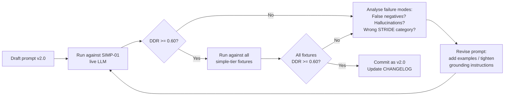

---

### Task P2-T08 — Simple-Tier Test Fixtures

| Attribute | Detail |
|-----------|--------|
| **Task ID** | P2-T08 |
| **Estimate** | 5–6 hours |
| **Status** | To Do |
| **Depends On** | P2-T01, P1-T02 |

**Description:** Create the simple-tier test scenarios — the second level of the graduated test suite. Each scenario pairs a two-tier Terraform architecture with a matching design document and a manually compiled ground-truth file that includes both regular STRIDE threats and explicit discrepancies.

**Test Scenarios:**

| ID | Architecture | Terraform Resources | Planted Discrepancies | Known STRIDE Threats |
|----|-------------|--------------------|-----------------------|---------------------|
| `SIMP-01` | Two-tier web app (EC2 + RDS) | `aws_instance`, `aws_db_instance`, `aws_security_group` | DB publicly accessible (design says private); no encryption at rest (design says encrypted) | 1× Tampering, 1× Info Disclosure, 2× Discrepancies |
| `SIMP-02` | Static site with CDN (S3 + CloudFront) | `aws_s3_bucket`, `aws_cloudfront_distribution` | S3 bucket has `acl = public-read` (design says internal); CloudFront using HTTP origin (design says HTTPS only) | 1× Info Disclosure, 1× Tampering, 2× Discrepancies |
| `SIMP-03` | Serverless API (Lambda + API Gateway + DynamoDB) | `aws_lambda_function`, `aws_api_gateway_rest_api`, `aws_dynamodb_table` | Lambda has over-permissive IAM role (design says least privilege); API Gateway has no authorization (design says API key required) | 2× Elevation of Privilege, 2× Discrepancies |

**Fixture File Layout:**

```
tests/fixtures/
├── simple/
│   ├── simp_01/
│   │   ├── main.tf                # Terraform fixture (EC2 + RDS)
│   │   ├── design_doc.md          # Matching design document
│   │   └── ground_truth.json      # Known threats + discrepancies
│   ├── simp_02/
│   │   ├── main.tf
│   │   ├── design_doc.md
│   │   └── ground_truth.json
│   └── simp_03/
│       ├── main.tf
│       ├── design_doc.md
│       └── ground_truth.json
```

**Ground Truth JSON Structure:**

```json
{
  "scenario_id": "SIMP-01",
  "known_threats": [
    {
      "stride_category": "Information Disclosure",
      "component": "aws_db_instance.app_db",
      "discrepancy_flag": true
    }
  ],
  "known_discrepancies": [
    {
      "component": "aws_db_instance.app_db",
      "design_statement": "Database must not be publicly accessible",
      "iac_attribute": "publicly_accessible = true"
    }
  ],
  "total_threats": 4,
  "total_discrepancies": 2
}
```

**Acceptance Criteria:**
- [ ] All three scenario directories created with valid `.tf` files, design documents (min 300 words each), and `ground_truth.json`
- [ ] Design documents are realistic — they read like actual engineering docs, not test stubs
- [ ] Each ground-truth file contains at least 2 known discrepancies and at least 2 regular STRIDE threats
- [ ] A `fixtures/README.md` describes each scenario, the planted discrepancies, and the rationale for why they represent realistic misconfigurations

---

### Task P2-T09 — Discrepancy Detection Integration Tests

| Attribute | Detail |
|-----------|--------|
| **Task ID** | P2-T09 |
| **Estimate** | 4–5 hours |
| **Status** | To Do |
| **Depends On** | P2-T07, P2-T08, P2-T06 |

**Description:** Write the integration test suite that validates the discrepancy detection capability end-to-end for all simple-tier scenarios. Both mocked (unit-level) and live (evaluation-level) test runs are required.

**Acceptance Criteria:**
- [ ] Integration test for each simple-tier scenario runs the full multi-source pipeline with **mocked LLM responses** and verifies structural correctness (valid JSON schema, `discrepancy_flag` field present and boolean, `discrepancy_detail` populated when flag is `true`)
- [ ] A **live evaluation script** (`tests/eval/run_phase2_eval.py`) runs all simple-tier scenarios against a real LLM and computes: Precision, Recall, and **Discrepancy Detection Rate (DDR)** per scenario
- [ ] DDR is computed as: `(correctly identified discrepancies) / (total planted discrepancies)` — a DDR >= 0.75 is the target
- [ ] Results are written to `tests/results/phase2_eval_results.json` in a structured format for later analysis
- [ ] A regression test ensures that the Phase 1 IaC-only path still passes all trivial-tier scenarios after the Phase 2 upgrades (no regressions)

**Evaluation Metrics Computed per Scenario:**

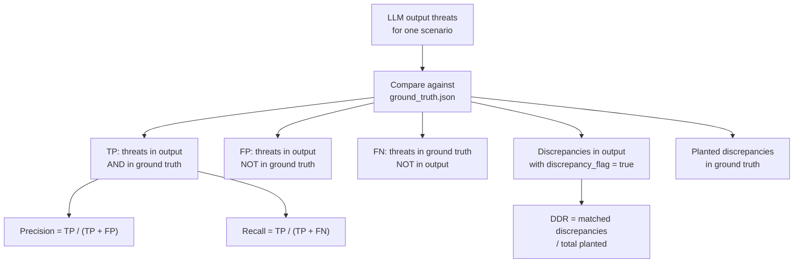

---

### Task P2-T10 — CLI Activation and End-to-End Smoke Test

| Attribute | Detail |
|-----------|--------|
| **Task ID** | P2-T10 |
| **Estimate** | 2–3 hours |
| **Status** | To Do |
| **Depends On** | P2-T01 through P2-T09 |

**Description:** Activate the `--doc` flag in the CLI entry point to trigger the multi-source path and run a final end-to-end smoke test confirming the complete Phase 2 pipeline works as a CLI command. This task closes Phase 2.

**Acceptance Criteria:**
- [ ] `python -m threatcli analyze --iac tests/fixtures/simple/simp_01/main.tf --doc tests/fixtures/simple/simp_01/design_doc.md --format text` runs without error and prints a threat list that includes at least one entry with `discrepancy_flag: true` visible in the output
- [ ] `--format json` output for the same scenario is valid JSON with at least one threat object where `discrepancy_flag` is `true` and `discrepancy_detail` is a non-empty string
- [ ] Running with `--doc` pointing to a non-existent file prints a clear error and exits non-zero
- [ ] Running with `--doc` pointing to an empty file logs a warning, falls back to IaC-only mode, and completes successfully
- [ ] CI pipeline passes with all Phase 1 and Phase 2 tests (mocked) on the `main` branch

**Phase 2 End-to-End Flow:**

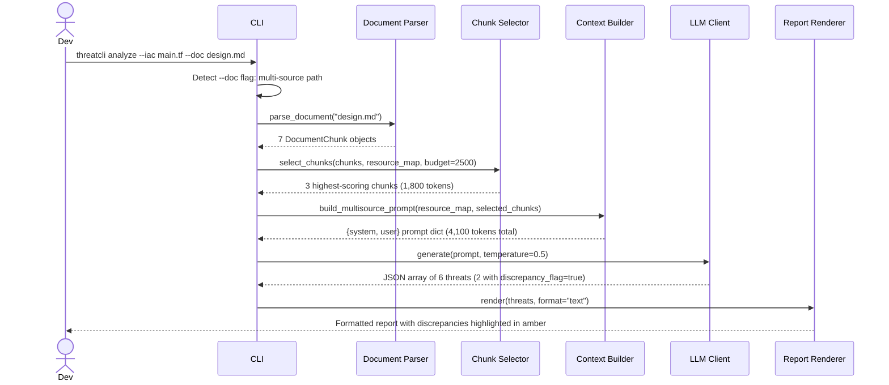

---

## 8. Phase 2 Task Summary

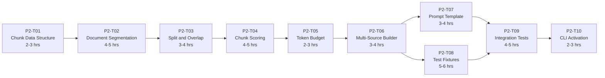

| Task ID | Title | Estimate | Depends On | Status |
|---------|-------|----------|------------|--------|
| P2-T01 | Chunk Data Structure and Token Estimator | 2–3 hrs | P1-T01 | To Do |
| P2-T02 | Heading-Aware Document Segmentation | 4–5 hrs | P2-T01 | To Do |
| P2-T03 | Paragraph-Level Split and Overlap Logic | 3–4 hrs | P2-T02 | To Do |
| P2-T04 | Chunk Scoring and Selection | 4–5 hrs | P2-T03, P1-T02 | To Do |
| P2-T05 | Token Budget Allocator | 2–3 hrs | P2-T04, P1-T03 | To Do |
| P2-T06 | Multi-Source Context Builder | 3–4 hrs | P2-T05, P2-T04 | To Do |
| P2-T07 | Multi-Source Prompt Template | 3–4 hrs | P2-T06 | To Do |
| P2-T08 | Simple-Tier Test Fixtures | 5–6 hrs | P2-T01, P1-T02 | To Do |
| P2-T09 | Discrepancy Detection Integration Tests | 4–5 hrs | P2-T07, P2-T08, P2-T06 | To Do |
| P2-T10 | CLI Activation and End-to-End Smoke Test | 2–3 hrs | P2-T01–P2-T09 | To Do |
| | **Total Estimate** | **32–42 hrs** | | |

---

## 9. Evaluation Hooks for RQ1

Phase 2 directly produces the artefacts needed to run Experiment A and Experiment B from the Evaluation Methodology. This section summarises how the evaluation plan maps to the Phase 2 tasks.

### RQ1 Experiment Mapping

| Experiment | What It Tests | Phase 2 Artefact |
|-----------|--------------|-----------------|
| **Experiment A** — IaC Only (baseline) | Precision and Recall using only Terraform input | Phase 1 pipeline + trivial/simple-tier fixtures (no design doc) |
| **Experiment B** — Multi-Source | Precision, Recall, and DDR using both inputs | Phase 2 pipeline + simple-tier fixtures with design docs |
| **Comparison** | Whether multi-source improves Recall on discrepancy threats | Comparing Experiment A vs B results per scenario |

### Metrics Targets

| Metric | Formula | Target | Measured In |
|--------|---------|--------|------------|
| Precision | `TP / (TP + FP)` | >= 0.80 | P2-T09 eval script |
| Recall | `TP / (TP + FN)` | >= 0.70 | P2-T09 eval script |
| Discrepancy Detection Rate | `matched_discrepancies / planted_discrepancies` | >= 0.75 | P2-T09 eval script |
| Hallucination Rate | `threats referencing non-existent components / total threats` | <= 0.10 | P2-T09 eval script |

### Expected Result Pattern

The hypothesis is that Experiment B (multi-source) will improve **Recall** on discrepancy-type threats while **Precision** remains roughly stable. The chart below illustrates the expected pattern (target values, not measured):

```
Metric          Exp A (IaC only)    Exp B (Multi-source)    Delta
-----------     ----------------    --------------------    -----
Precision           ~0.82               ~0.80               -0.02  (acceptable)
Recall              ~0.65               ~0.78               +0.13  (key gain)
DDR                 N/A                 ~0.78               N/A
```

If multi-source input _reduces_ precision significantly (introducing noise) that is itself a significant finding worth reporting.

---

## 10. Technical Risks and Mitigations

| Risk | Likelihood | Impact | Mitigation |
|------|-----------|--------|-----------|
| Chunk Selector scores irrelevant chunks highly due to generic security vocabulary | Medium | Medium | Tune weights empirically during P2-T07 prompt iteration. Add a minimum keyword co-occurrence threshold (chunk must match at least one resource name OR two security terms to be eligible). |
| Design documents in fixtures read as unconvincing or too brief for the LLM to extract useful signal | Medium | High | Write fixtures with a minimum of 300 words per section. Use realistic engineering language. Have at least one section that explicitly names the Terraform resources described. |
| LLM inconsistently populates `discrepancy_detail` with useful content despite prompt instructions | High | Medium | Add a post-processing validation step: if `discrepancy_flag = true` but `discrepancy_detail` is empty or shorter than 20 characters, re-prompt with a targeted correction asking for the specific conflict description. |
| Token budget calculations are off due to tokeniser mismatch (character heuristic vs actual BPE) | Medium | Low | The 4-char-per-token heuristic will never overcount — it is conservative. Add a 10% safety margin to all budget limits. |
| Overlap logic introduces duplicate content that confuses the LLM | Low | Medium | Keep overlap to 100 tokens (approximately 2–3 sentences). In the prompt header for each chunk, note when overlap is present so the LLM can account for it. |
| Phase 1 pipeline regresses after Context Builder upgrade | Low | High | Regression test suite (part of P2-T09) re-runs all 5 trivial-tier Phase 1 scenarios after every merge to `main`. |

---

*Document end. Phase 3 (CLI Refinement and Evaluation Framework) tasks to follow.*
