# Automated Threat Modeling CLI using LLMs
## Phase 3 — CLI Refinement and Evaluation Framework

> **Author:** Mohammed Farhan · **Version:** 1.0 · **Date:** March 2026 · **Status:** Draft  
> **Builds on:** Phase 1 (IaC Parser, LLM Client, IaC-Only Pipeline) · Phase 2 (Document Parser, Context Fusion, Discrepancy Detection)  
> **Timeline:** Weeks 8–10 (May)

---

## Table of Contents

1. [Phase 3 Overview](#1-phase-3-overview)
2. [What Changes in Phase 3](#2-what-changes-in-phase-3)
3. [CLI Refinement — Deep Design](#3-cli-refinement--deep-design)
4. [Evaluation Harness Architecture](#4-evaluation-harness-architecture)
5. [Experiment Designs](#5-experiment-designs)
6. [Reliability and Consistency Testing](#6-reliability-and-consistency-testing)
7. [Hallucination Detection](#7-hallucination-detection)
8. [Phase 3 Tasks](#8-phase-3-tasks)
9. [Phase 3 Task Summary](#9-phase-3-task-summary)
10. [Full Experiment Run Plan](#10-full-experiment-run-plan)
11. [Technical Risks and Mitigations](#11-technical-risks-and-mitigations)

---

## 1. Phase 3 Overview

Phases 1 and 2 built a working end-to-end pipeline. Phase 3 shifts focus from feature implementation to **quality, reliability, and measurability**. The three objectives are:

1. **Polish the CLI** — output formatting, flag options, robust error handling for all edge cases the first two phases left rough.
2. **Build the evaluation harness** — automated scripts that run experiments, collect LLM outputs, and compute all metrics defined in the Evaluation Methodology (Precision, Recall, DDR, Jaccard Index, Hallucination Rate).
3. **Run the initial evaluation pass** — execute Experiments A, B, C, and D across the full graduated test suite and record results against the metric targets.

This phase directly serves **Research Questions 1, 2, and 3**.

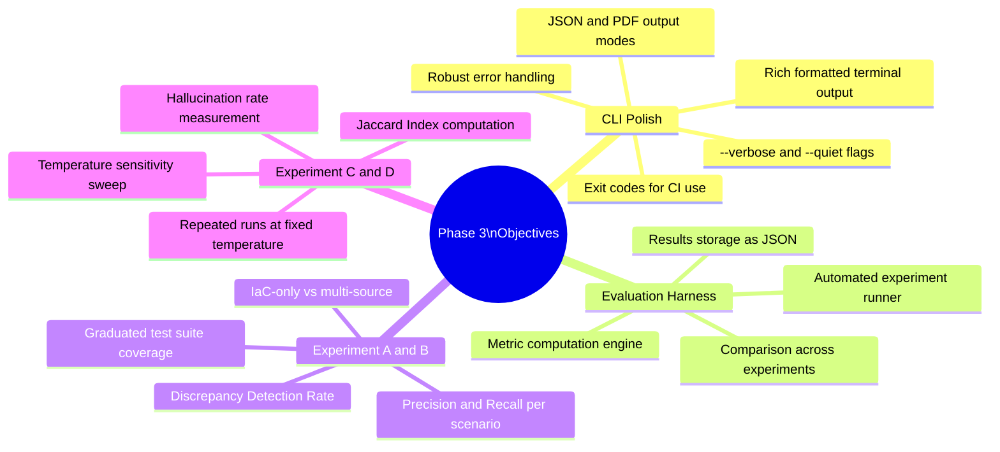

### Phase 3 in the Project Arc

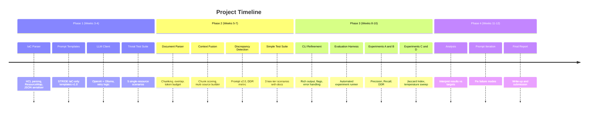

---

## 2. What Changes in Phase 3

Phase 3 adds no new pipeline stages. Instead it hardens what exists and wraps it in a rigorous measurement layer.

### Component Change Summary

| Component | Phase 2 State | Phase 3 Change |
|-----------|--------------|----------------|
| `cli.py` | Feature-complete but rough edges — basic output, minimal error handling | **Polished** — Rich formatting, `--format pdf`, `--verbose`, `--quiet`, structured exit codes |
| `renderer.py` | Text output only (Rich stub) | **Completed** — full Rich terminal renderer, JSON writer, PDF renderer via ReportLab |
| `evaluation/` directory | Does not exist | **New** — experiment runner, metric engine, result store |
| `evaluation/runner.py` | — | **New** — orchestrates full experiment runs across all scenarios |
| `evaluation/metrics.py` | — | **New** — Precision, Recall, DDR, Jaccard, Hallucination Rate |
| `evaluation/results/` | — | **New** — structured JSON results files per experiment |
| Test suite | 5 trivial + 3 simple scenarios | **Extended** — moderate + complex scenarios added for full graduated coverage |

### What Is NOT Changing in Phase 3

- The IaC Parser (`iac_parser.py`) — frozen after Phase 1
- The Document Parser (`doc_parser.py`) — frozen after Phase 2
- The Context Builder (`context_builder.py`) — frozen unless evaluation reveals a specific bug
- The LLM Client (`llm_client.py`) — frozen unless a provider API changes
- Prompt templates — may receive minor refinements based on Experiment A/B results, but no structural changes

---

## 3. CLI Refinement — Deep Design

### 3.1 Output Formatting

The Report Renderer (`renderer.py`) is completed in Phase 3 to support all three output formats properly.

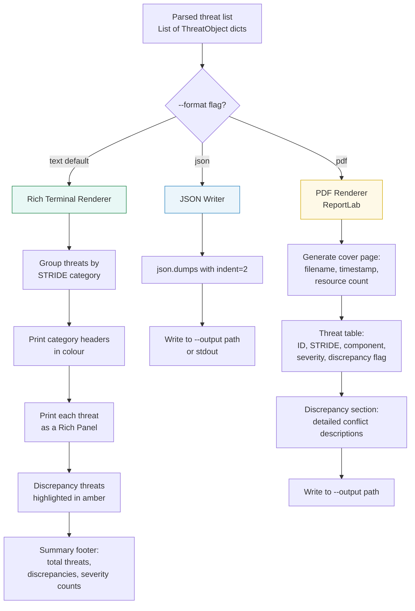

### 3.2 Rich Terminal Output Design

The terminal renderer uses the Rich library to produce structured, readable output without overwhelming the user.

```
╔══════════════════════════════════════════════════════════════╗
║  Threat Model Report                                         ║
║  Source: infra/main.tf + docs/architecture.md                ║
║  Generated: 2026-05-12 14:32:01  │  Provider: openai/gpt-4o ║
╚══════════════════════════════════════════════════════════════╝

INFORMATION DISCLOSURE  (3 threats)
──────────────────────────────────
  T-001  aws_s3_bucket.assets                           HIGH  ⚠ DISCREPANCY
         S3 bucket has public-read ACL. Design doc states internal-only.

  T-002  aws_db_instance.app_db                         HIGH
         RDS instance publicly accessible; credentials in Terraform state.

  T-003  aws_lambda_function.processor                  MEDIUM
         Plaintext API_KEY in environment variables.

ELEVATION OF PRIVILEGE  (2 threats)
────────────────────────────────────
  T-004  aws_iam_role.lambda_exec                       HIGH  ⚠ DISCREPANCY
         IAM role has AdministratorAccess. Design requires least privilege.

  T-005  aws_security_group.web_sg                      MEDIUM
         Ingress 0.0.0.0/0 on port 22 exposes SSH to the internet.

────────────────────────────────────────────────────────────────
  5 threats  │  2 discrepancies  │  2 High  │  2 Medium  │  1 Low
```

### 3.3 New and Refined CLI Flags

| Flag | Type | Phase | Description |
|------|------|-------|-------------|
| `--format / -f` | `text\|json\|pdf` | Refined | PDF mode now fully implemented |
| `--output / -o` | Path | Refined | Required when `--format pdf`; optional for `json`; ignored for `text` |
| `--verbose` | Boolean flag | **New** | Print debug info: token counts, chunk selection scores, prompt size |
| `--quiet` | Boolean flag | **New** | Suppress all output except the threat list (useful in CI pipelines) |
| `--no-colour` | Boolean flag | **New** | Disable Rich colour codes (for plain terminals or log capture) |
| `--severity-filter` | `High\|Medium\|Low` | **New** | Only include threats at or above the specified severity level |
| `--stride-filter` | Enum (multiple) | **New** | Only include threats in the specified STRIDE categories |
| `--temperature` | Float 0.0–1.0 | Refined | Now validated at startup; rejects values outside [0.0, 1.0] |
| `--runs` | Int >= 1 | **New** | Run the analysis N times and merge results (for reliability experiments) |

### 3.4 Exit Codes

Structured exit codes allow the CLI to be integrated cleanly into CI/CD pipelines.

| Code | Meaning | Trigger |
|------|---------|---------|
| `0` | Success — threats generated | Normal completion |
| `1` | Error — input validation failed | Missing required file, unreadable path |
| `2` | Error — LLM client error | API failure after all retries exhausted |
| `3` | Error — output write failure | Cannot write to `--output` path |
| `10` | Success with findings — High severity | At least one High-severity threat found |
| `11` | Success with findings — discrepancy | At least one discrepancy detected |

> Exit codes 10 and 11 are non-zero but represent successful analysis. CI pipelines can use these to gate deployments when critical security issues are found. Codes 10 and 11 can be disabled with `--strict-exit-zero`.

### 3.5 Error Handling Hardening

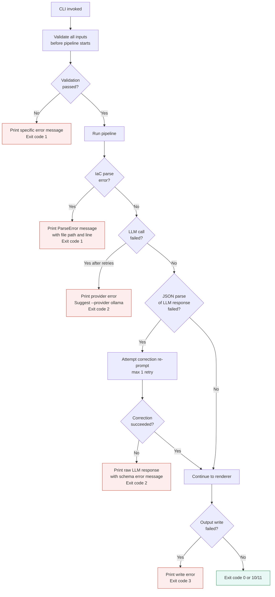

---

## 4. Evaluation Harness Architecture

The evaluation harness is a self-contained subsystem (`evaluation/`) that automates the running of experiments, computation of metrics, and storage of results. It is designed to be runnable both interactively and as a CI job.

### 4.1 Directory Structure

```
evaluation/
├── runner.py          # Orchestrates experiment runs
├── metrics.py         # All metric computation functions
├── comparator.py      # Compares outputs to ground truth
├── harness.py         # Entry point: python -m evaluation.harness
├── config/
│   ├── experiment_a.yaml   # Experiment A configuration
│   ├── experiment_b.yaml   # Experiment B configuration
│   ├── experiment_c.yaml   # Experiment C configuration (reliability)
│   └── experiment_d.yaml   # Experiment D configuration (temperature)
└── results/
    ├── experiment_a/
    │   ├── run_20260512_143201.json
    │   └── summary.json
    ├── experiment_b/
    ├── experiment_c/
    └── experiment_d/
```

### 4.2 Harness Architecture

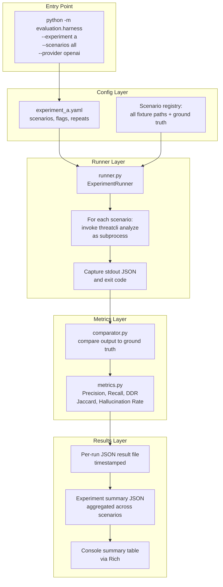

### 4.3 Experiment Configuration Format

Each experiment is defined in a YAML config file that specifies which scenarios to run, how many times, and with what CLI flags.

```yaml
# evaluation/config/experiment_a.yaml
experiment_id: "A"
name: "IaC Only — Baseline"
description: "Run IaC-only pipeline against all graduated test scenarios"
research_question: "RQ1, RQ2"

scenarios:
  - id: trivial
    fixtures:
      - tests/fixtures/trivial/tri_01
      - tests/fixtures/trivial/tri_02
      - tests/fixtures/trivial/tri_03
      - tests/fixtures/trivial/tri_04
      - tests/fixtures/trivial/tri_05
  - id: simple
    fixtures:
      - tests/fixtures/simple/simp_01
      - tests/fixtures/simple/simp_02
      - tests/fixtures/simple/simp_03
  - id: moderate
    fixtures:
      - tests/fixtures/moderate/mod_01
      - tests/fixtures/moderate/mod_02
  - id: complex
    fixtures:
      - tests/fixtures/complex/comp_01

cli_flags:
  format: json
  provider: openai
  model: gpt-4o
  temperature: 0.5
  # Note: --doc is NOT passed for Experiment A

repeats: 1
metrics:
  - precision
  - recall
  - hallucination_rate
```

### 4.4 Result File Schema

Every experiment run produces a timestamped JSON result file.

```json
{
  "experiment_id": "A",
  "run_id": "run_20260512_143201",
  "timestamp": "2026-05-12T14:32:01Z",
  "provider": "openai",
  "model": "gpt-4o",
  "temperature": 0.5,
  "scenario_results": [
    {
      "scenario_id": "TRI-01",
      "fixture_path": "tests/fixtures/trivial/tri_01",
      "threats_generated": 3,
      "ground_truth_threats": 1,
      "tp": 1,
      "fp": 2,
      "fn": 0,
      "precision": 0.33,
      "recall": 1.00,
      "discrepancies_generated": 0,
      "discrepancies_ground_truth": 0,
      "ddr": null,
      "hallucination_count": 0,
      "hallucination_rate": 0.00,
      "token_estimate_prompt": 1240,
      "latency_seconds": 4.2
    }
  ],
  "aggregate": {
    "mean_precision": 0.84,
    "mean_recall": 0.79,
    "mean_ddr": null,
    "mean_hallucination_rate": 0.03,
    "total_scenarios": 11,
    "total_threats_generated": 47,
    "total_ground_truth_threats": 39
  }
}
```

---

## 5. Experiment Designs

The four experiments map directly to the three research questions. Experiments A and B address RQ1 and RQ2; Experiments C and D address RQ3.

### 5.1 Experiment Map

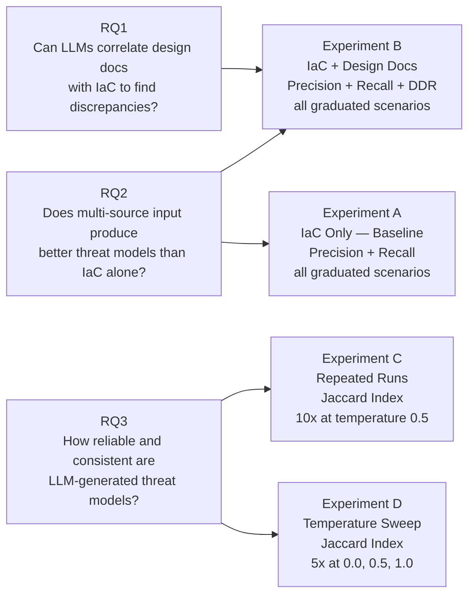

### 5.2 Experiment A — IaC Only (Baseline)

**Purpose:** Establish a baseline for how well the tool identifies threats using only Terraform input, with no design document context. Results from this experiment are used as the denominator in the RQ2 comparison.

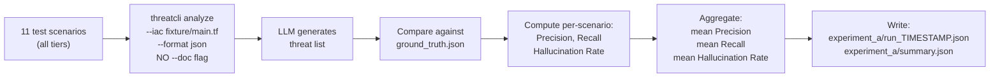

**Metrics computed:**

| Metric | Formula | Target |
|--------|---------|--------|
| Precision | `TP / (TP + FP)` | >= 0.80 |
| Recall | `TP / (TP + FN)` | >= 0.70 |
| Hallucination Rate | `non-existent component references / total threats` | <= 0.10 |

**Scenario coverage:**

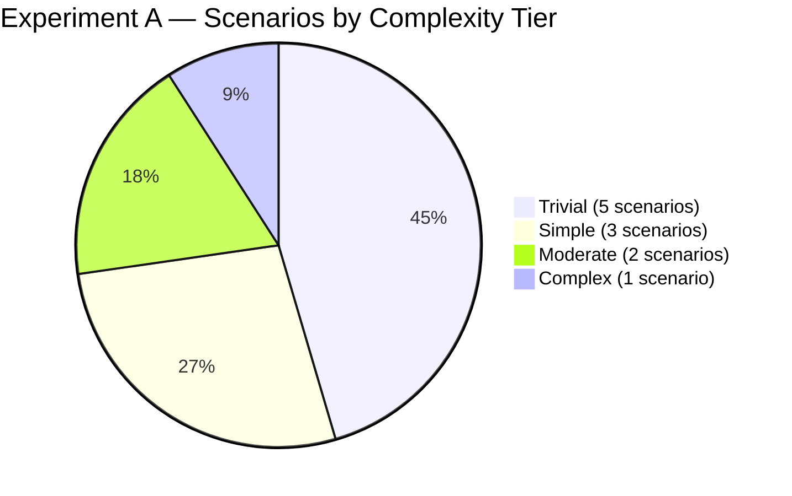

### 5.3 Experiment B — IaC + Design Documents (Multi-Source)

**Purpose:** Repeat Experiment A with both inputs active. This directly tests the hypothesis that multi-source input improves Recall on discrepancy-type threats while keeping Precision stable.

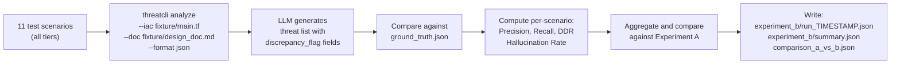

**Additional metric — Discrepancy Detection Rate:**

```
DDR = (threats with discrepancy_flag=true that match a planted discrepancy)
      ───────────────────────────────────────────────────────────────────
      (total planted discrepancies in ground_truth.json)
```

DDR is only meaningful for scenarios that have planted discrepancies (simple, moderate, and complex tiers). It is `null` for trivial-tier scenarios in Experiment A (which have no design document).

**Expected comparison pattern:**

| Metric | Exp A (IaC Only) | Exp B (Multi-Source) | Hypothesis |
|--------|-----------------|---------------------|-----------|
| Precision | Baseline | Stable (±0.05) | Adding doc context should not add many false positives |
| Recall | Baseline | Higher (+0.10 to +0.15) | Design doc context surfaces discrepancy-type threats that IaC alone misses |
| DDR | N/A | >= 0.75 | Most planted discrepancies should be detected when design doc is present |
| Hallucination Rate | Baseline | Stable or lower | Grounding on a second source should reduce hallucinations |

---

## 6. Reliability and Consistency Testing

Experiments C and D address Research Question 3: how reliable and consistent are LLM-generated threat models under varying conditions?

### 6.1 Why Reliability Matters

LLMs are stochastic by default. Two runs of the identical prompt can yield different threat lists — different threats, different orderings, different severity assignments. For a tool intended for integration into security workflows, this variability must be characterised and bounded.

### 6.2 Jaccard Index — the Core Reliability Metric

The Jaccard Index measures the similarity between two sets. Applied to threat lists, it measures how much two runs of the same scenario agree on which threats to report.

```
        | A ∩ B |
J(A,B) = ─────────
        | A ∪ B |
```

**Threat identity for Jaccard computation:** Two threats are considered the same if they share the same `stride_category` AND `component`. Description text is excluded from the comparison because the LLM may paraphrase differently across runs while identifying the same threat.

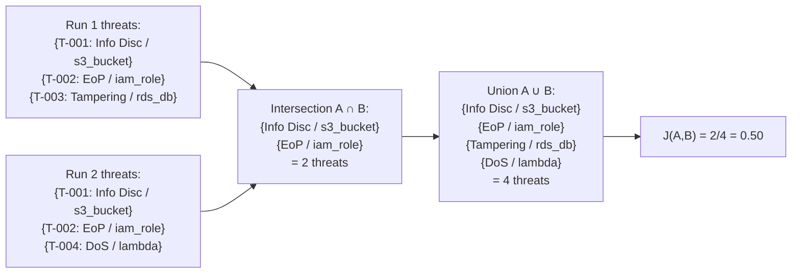

**Interpretation:**

| Jaccard Score | Interpretation |
|---------------|---------------|
| >= 0.90 | Highly consistent — effectively deterministic output |
| 0.70 – 0.89 | Acceptable consistency — reliable for practical use |
| 0.50 – 0.69 | Marginal — noticeable variability, recommend temperature reduction |
| < 0.50 | Unacceptable — output too variable for security workflow use |

**Target:** Mean pairwise Jaccard >= 0.70 at default temperature (0.5).

### 6.3 Experiment C — Repeated Runs at Default Temperature

**Setup:** Run the same moderate-complexity scenario 10 times with identical inputs and temperature = 0.5.

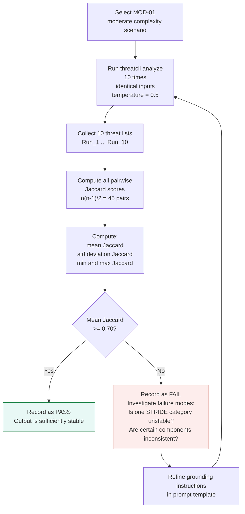

**Output — Jaccard Heatmap (illustrative):**

```
           Run1  Run2  Run3  Run4  Run5  Run6  Run7  Run8  Run9  Run10
Run1        1.00  0.82  0.78  0.85  0.80  0.79  0.83  0.81  0.77  0.84
Run2        0.82  1.00  0.81  0.87  0.83  0.82  0.85  0.80  0.79  0.82
Run3        0.78  0.81  1.00  0.80  0.77  0.79  0.80  0.78  0.76  0.79
...
Mean pairwise Jaccard: 0.81
Std deviation:         0.03
```

**Results stored in:** `evaluation/results/experiment_c/run_TIMESTAMP.json`

### 6.4 Experiment D — Temperature Sensitivity Sweep

**Setup:** Run the same moderate-complexity scenario 5 times at each of three temperature settings: 0.0, 0.5, and 1.0.

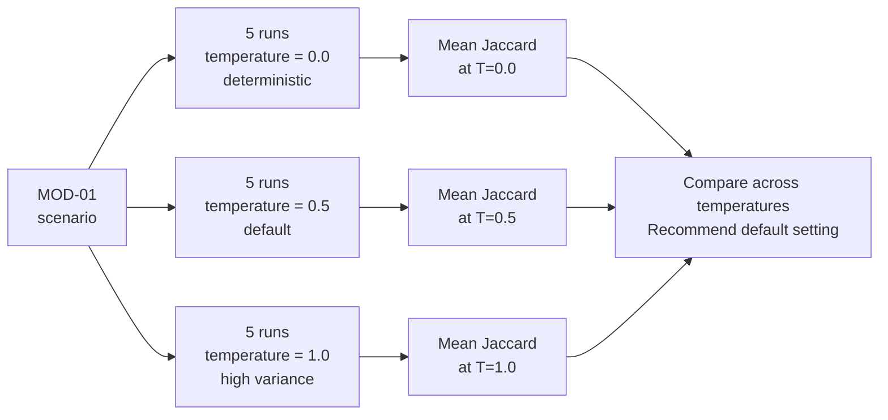

**Expected results:**

| Temperature | Expected Jaccard | Expected Behaviour |
|-------------|-----------------|-------------------|
| 0.0 | ~0.95+ | Near-deterministic; very high consistency but may be less creative in identifying edge-case threats |
| 0.5 | ~0.80 | Good balance of consistency and coverage |
| 1.0 | ~0.55 | High variability; some runs may produce novel valid threats, others may hallucinate |

**Decision rule:** The recommended default temperature is the lowest value that achieves Jaccard >= 0.70 and Recall >= 0.70 simultaneously. If temperature 0.0 meets both, it becomes the recommended default.

---

## 7. Hallucination Detection

Hallucination — the LLM generating threats that reference components not present in the input — is measured across all experiments. Phase 3 introduces a systematic detection pass.

### 7.1 Detection Algorithm

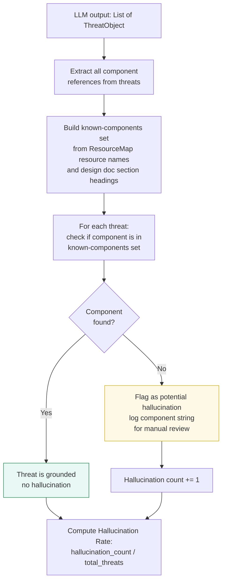

### 7.2 Matching Rules

The component comparison is fuzzy — the LLM may refer to `aws_s3_bucket.assets` as `S3 bucket`, `assets bucket`, or `the S3 storage component`. The following matching rules are applied in order:

| Rule | Example Match | Confidence |
|------|--------------|-----------|
| Exact match against `resource_type.resource_name` | `aws_s3_bucket.assets` | High |
| Partial match: resource name only | `assets` in threat component | Medium |
| Partial match: resource type only | `s3_bucket` or `S3` in component | Low |
| No match | `audit_log_service` (not in Terraform) | Hallucination |

Only threats with **no match at any confidence level** are counted as hallucinations. Medium and low confidence matches are flagged in the result file for manual review but are not counted as hallucinations.

### 7.3 Hallucination Rate Target

```
Hallucination Rate = hallucinated threats / total threats generated

Target: <= 0.10 (no more than 1 in 10 threats references a non-existent component)
```

If the hallucination rate exceeds 0.10 on any experiment, the grounding instructions in the prompt templates are revised and the affected experiments are re-run.

---

## 8. Phase 3 Tasks

> **Timeline:** Weeks 8–10 (May) · **Goal:** Complete CLI polish, build the evaluation harness, run Experiments A–D, and record initial results.

```mermaid
gantt
    title Phase 3 Task Schedule (3 Weeks)
    dateFormat  DD
    axisFormat  Day %d

    section CLI Refinement
    P3-T01 Rich Terminal Renderer         :t01, 01, 2d
    P3-T02 PDF Renderer                   :t02, after t01, 2d
    P3-T03 New Flags and Exit Codes       :t03, after t01, 2d
    P3-T04 Error Handling Hardening       :t04, after t03, 1d

    section Evaluation Harness
    P3-T05 Metrics Engine                 :t05, after t04, 3d
    P3-T06 Comparator                     :t06, after t05, 2d
    P3-T07 Experiment Runner              :t07, after t06, 2d
    P3-T08 Experiment Config Files        :t08, after t07, 1d

    section Test Suite Extension
    P3-T09 Moderate Tier Fixtures         :t09, after t04, 4d
    P3-T10 Complex Tier Fixture           :t10, after t09, 2d

    section Experiments
    P3-T11 Run Experiments A and B        :t11, after t08, 2d
    P3-T12 Run Experiments C and D        :t12, after t11, 2d
    P3-T13 Results Review and Re-run      :t13, after t12, 2d
```

---

### Task P3-T01 — Rich Terminal Renderer

| Attribute | Detail |
|-----------|--------|
| **Task ID** | P3-T01 |
| **Estimate** | 3–4 hours |
| **Status** | To Do |
| **Depends On** | P2-T10 (Phase 2 complete) |

**Description:** Complete the terminal renderer in `renderer.py` using the Rich library. The Phase 1/2 implementation produced raw text; this task produces the structured, colour-coded output described in Section 3.2.

**Acceptance Criteria:**
- [ ] Threats are grouped under STRIDE category headers rendered with Rich `Rule` separators
- [ ] Each threat is rendered as a Rich `Panel` containing: threat ID, component, severity badge, description
- [ ] Threats with `discrepancy_flag = true` are highlighted with an amber `[⚠ DISCREPANCY]` badge
- [ ] A summary footer is printed after all threats: total count, discrepancy count, severity breakdown
- [ ] A header block shows: source files, timestamp, LLM provider and model
- [ ] `--no-colour` flag disables all Rich styling and produces plain text output
- [ ] `--severity-filter High` correctly suppresses Medium and Low threats
- [ ] `--stride-filter "Information Disclosure" "Elevation of Privilege"` correctly filters to the named categories
- [ ] Unit tests verify: correct grouping, discrepancy badge presence, severity filter logic, colour disable mode

---

### Task P3-T02 — PDF Renderer

| Attribute | Detail |
|-----------|--------|
| **Task ID** | P3-T02 |
| **Estimate** | 4–5 hours |
| **Status** | To Do |
| **Depends On** | P3-T01 |

**Description:** Implement the PDF renderer using ReportLab. The PDF is intended as a shareable artefact — a formatted security report that can be handed to a client or stored as an audit record.

**Acceptance Criteria:**
- [ ] `--format pdf --output report.pdf` generates a valid, openable PDF file
- [ ] PDF contains: cover page (title, source files, timestamp, tool version), executive summary (total threats, severity breakdown, discrepancy count), threat table (ID, STRIDE category, component, severity, discrepancy flag), discrepancy detail section (full `discrepancy_detail` text per flagged threat)
- [ ] PDF is styled consistently: monospace font for resource names and code references, sans-serif for body text, coloured severity badges
- [ ] Threats with `discrepancy_flag = true` appear in amber in the threat table and have their full detail rendered in the discrepancy section
- [ ] PDF renders correctly with 0, 1, and 50+ threats (no layout overflow errors)
- [ ] Running without `--output` when `--format pdf` is set prints a clear error and exits with code 1

---

### Task P3-T03 — New Flags and Exit Codes

| Attribute | Detail |
|-----------|--------|
| **Task ID** | P3-T03 |
| **Estimate** | 2–3 hours |
| **Status** | To Do |
| **Depends On** | P2-T10 |

**Description:** Implement all new CLI flags defined in Section 3.3 and the structured exit code scheme from Section 3.4. These are the changes that make the tool usable in CI/CD pipelines.

**Acceptance Criteria:**
- [ ] `--verbose` prints token counts, chunk selection scores, prompt size, and LLM latency to stderr (not stdout, so JSON output remains clean)
- [ ] `--quiet` suppresses all output except the final threat list
- [ ] `--runs N` invokes the LLM N times and merges results (union of threat sets, deduplicating by `stride_category` + `component`)
- [ ] `--severity-filter` and `--stride-filter` implemented and correctly applied before rendering
- [ ] Exit code 10 is returned when any High-severity threat is present (regardless of error state)
- [ ] Exit code 11 is returned when any discrepancy is detected (takes precedence over exit code 10 if both apply — code 11 is returned)
- [ ] `--strict-exit-zero` overrides codes 10 and 11, returning 0 on success regardless of findings
- [ ] Unit tests verify all exit code scenarios

---

### Task P3-T04 — Error Handling Hardening

| Attribute | Detail |
|-----------|--------|
| **Task ID** | P3-T04 |
| **Estimate** | 2–3 hours |
| **Status** | To Do |
| **Depends On** | P3-T03 |

**Description:** Implement the full error handling flowchart from Section 3.5. All error paths must produce actionable, specific error messages and the correct exit code. No unhandled exceptions should escape to the top level.

**Acceptance Criteria:**
- [ ] A top-level `try/except` in `cli.py` catches any unhandled exception, prints a user-friendly message with a suggestion to run with `--verbose` for debug info, and exits with code 2
- [ ] All `ParseError` exceptions include the file path and, where available, the problematic line
- [ ] LLM correction re-prompt is implemented: on JSON parse failure, one re-prompt is attempted with the parse error appended; on second failure, the raw response is saved to a debug file and code 2 is returned
- [ ] Empty Terraform input (all files parse to empty ResourceMaps) prints a warning and exits with code 1 rather than sending an empty prompt to the LLM
- [ ] Integration tests cover each error path in the flowchart using mocked inputs

---

### Task P3-T05 — Metrics Engine

| Attribute | Detail |
|-----------|--------|
| **Task ID** | P3-T05 |
| **Estimate** | 4–5 hours |
| **Status** | To Do |
| **Depends On** | P3-T04 |

**Description:** Implement `evaluation/metrics.py` — the module that computes all evaluation metrics from a pair of (LLM output, ground truth). This is the mathematical core of the evaluation harness and must be thoroughly unit-tested.

**Acceptance Criteria:**
- [ ] `compute_precision_recall(predicted: List[Threat], ground_truth: List[Threat]) -> Dict` returns `{tp, fp, fn, precision, recall}`
- [ ] Threat identity for matching uses `stride_category` + `component` (case-insensitive, strip whitespace)
- [ ] `compute_ddr(predicted: List[Threat], ground_truth_discrepancies: List[Discrepancy]) -> float` returns DDR or `None` if no ground-truth discrepancies exist
- [ ] `compute_jaccard(list_a: List[Threat], list_b: List[Threat]) -> float` returns the Jaccard Index for two threat sets
- [ ] `compute_pairwise_jaccard(runs: List[List[Threat]]) -> Dict` returns `{mean, std, min, max, matrix}` for N runs
- [ ] `compute_hallucination_rate(predicted: List[Threat], resource_map: dict, doc_chunks: List) -> Dict` returns `{hallucination_count, total_threats, hallucination_rate, flagged_components}`
- [ ] All functions handle edge cases: empty lists, single-item lists, all-match, no-match
- [ ] Unit tests achieve 100% line coverage on `metrics.py`

**Metric function signatures:**

```python
def compute_precision_recall(
    predicted: List[Dict],
    ground_truth: List[Dict]
) -> Dict[str, float]:
    """Returns {tp, fp, fn, precision, recall}"""

def compute_ddr(
    predicted: List[Dict],
    ground_truth_discrepancies: List[Dict]
) -> Optional[float]:
    """Returns DDR in [0,1] or None if no ground truth discrepancies"""

def compute_jaccard(
    list_a: List[Dict],
    list_b: List[Dict]
) -> float:
    """Returns Jaccard Index in [0,1]"""

def compute_pairwise_jaccard(
    runs: List[List[Dict]]
) -> Dict[str, Any]:
    """Returns {mean, std, min, max, n_pairs, matrix}"""

def compute_hallucination_rate(
    predicted: List[Dict],
    known_components: Set[str]
) -> Dict[str, Any]:
    """Returns {count, rate, flagged}"""
```

---

### Task P3-T06 — Comparator

| Attribute | Detail |
|-----------|--------|
| **Task ID** | P3-T06 |
| **Estimate** | 3–4 hours |
| **Status** | To Do |
| **Depends On** | P3-T05 |

**Description:** Implement `evaluation/comparator.py` — the module that loads ground-truth files, loads LLM output files, performs the fuzzy component matching for hallucination detection, and calls the metrics engine.

**Acceptance Criteria:**
- [ ] `load_ground_truth(fixture_path: str) -> GroundTruth` loads and validates `ground_truth.json`
- [ ] `load_llm_output(output_json: str) -> List[Threat]` parses the JSON threat list output by the CLI
- [ ] `build_known_components(resource_map: dict) -> Set[str]` generates the full set of known component identifiers at all confidence levels (exact, resource name only, resource type only)
- [ ] `compare(llm_output, ground_truth, resource_map) -> ScenarioResult` returns the full per-scenario result dict matching the result file schema
- [ ] Fuzzy matching implemented according to the three-level scheme in Section 7.2
- [ ] Unit tests cover: exact match, partial match, no match (hallucination), DDR with mixed correct and missed discrepancies

---

### Task P3-T07 — Experiment Runner

| Attribute | Detail |
|-----------|--------|
| **Task ID** | P3-T07 |
| **Estimate** | 4–5 hours |
| **Status** | To Do |
| **Depends On** | P3-T06 |

**Description:** Implement `evaluation/runner.py` — the orchestrator that reads an experiment config YAML, invokes the CLI for each scenario (as a subprocess), captures output, runs the comparator, aggregates metrics, and writes result files.

**Acceptance Criteria:**
- [ ] `ExperimentRunner.run(config_path: str) -> ExperimentResult` executes the full experiment and returns a structured result
- [ ] Each CLI invocation is run as a subprocess: `subprocess.run(["python", "-m", "threatcli", "analyze", ...], capture_output=True)`
- [ ] CLI flags from the experiment config YAML are passed verbatim to each subprocess invocation
- [ ] Results are written to `evaluation/results/{experiment_id}/run_{TIMESTAMP}.json` and `summary.json` is updated
- [ ] A Rich progress bar displays `Scenario X of Y` during the run
- [ ] On subprocess failure (non-zero exit code), the runner records the error and continues to the next scenario rather than aborting the entire experiment
- [ ] `--dry-run` flag prints the CLI command that would be executed for each scenario without actually running it

---

### Task P3-T08 — Experiment Configuration Files

| Attribute | Detail |
|-----------|--------|
| **Task ID** | P3-T08 |
| **Estimate** | 2–3 hours |
| **Status** | To Do |
| **Depends On** | P3-T07 |

**Description:** Write the four experiment YAML config files (A, B, C, D) as described in Section 4.3 and Section 5. These are declarative specifications — no code — but they must correctly reference all fixture paths and specify the right CLI flags for each experiment.

**Acceptance Criteria:**
- [ ] `experiment_a.yaml` — IaC-only, all 11 scenarios, temperature 0.5, 1 repeat, metrics: precision/recall/hallucination_rate
- [ ] `experiment_b.yaml` — Multi-source, all 11 scenarios, temperature 0.5, 1 repeat, metrics: precision/recall/ddr/hallucination_rate
- [ ] `experiment_c.yaml` — Multi-source, MOD-01 only, temperature 0.5, **10 repeats**, metrics: pairwise_jaccard
- [ ] `experiment_d.yaml` — Multi-source, MOD-01 only, temperatures [0.0, 0.5, 1.0], **5 repeats each**, metrics: pairwise_jaccard per temperature
- [ ] All fixture paths in the YAML files are valid relative paths from the project root
- [ ] A `python -m evaluation.harness --experiment a --dry-run` run prints the expected CLI commands without error

---

### Task P3-T09 — Moderate Tier Test Fixtures

| Attribute | Detail |
|-----------|--------|
| **Task ID** | P3-T09 |
| **Estimate** | 6–8 hours |
| **Status** | To Do |
| **Depends On** | P2-T08 (simple-tier fixtures for reference) |

**Description:** Create two moderate-complexity test scenarios. These involve multi-service architectures with VPCs, IAM roles, and API Gateways, and have richer design documents and a larger number of planted discrepancies than the simple tier.

**Test Scenarios:**

| ID | Architecture | Resources | Discrepancies | STRIDE Threats |
|----|-------------|-----------|--------------|----------------|
| `MOD-01` | Three-tier VPC app (ALB + EC2 ASG + RDS Multi-AZ) | `aws_vpc`, `aws_subnet` (public/private), `aws_alb`, `aws_autoscaling_group`, `aws_db_instance`, `aws_security_group` x3, `aws_iam_role` | NACL allows all inbound (design: strict ingress rules); RDS not in private subnet (design: isolated DB tier); EC2 instance profile over-permissive (design: least-privilege access) | 3 Discrepancies, 4 STRIDE threats (mix of all categories) |
| `MOD-02` | Serverless data pipeline (API Gateway + Lambda + SQS + S3 + DynamoDB) | `aws_api_gateway_rest_api`, `aws_lambda_function` x2, `aws_sqs_queue`, `aws_s3_bucket`, `aws_dynamodb_table`, `aws_iam_role` x2 | API Gateway has no WAF (design: WAF required); SQS queue not encrypted (design: all queues encrypted); Lambda DLQ not configured (design: error handling required) | 3 Discrepancies, 5 STRIDE threats |

**Acceptance Criteria:**
- [ ] Both scenario directories created with valid `.tf` files (minimum 60 lines each), realistic design documents (minimum 600 words each), and complete `ground_truth.json`
- [ ] Design documents describe the architecture at the level of an engineering RFC — they reference specific component names, security requirements, and access control policies
- [ ] `MOD-01` serves as the canonical scenario for Experiments C and D (reliability testing)
- [ ] Each ground-truth file contains total_threats, total_discrepancies, and per-threat entries with stride_category, component, and discrepancy_flag

---

### Task P3-T10 — Complex Tier Fixture

| Attribute | Detail |
|-----------|--------|
| **Task ID** | P3-T10 |
| **Estimate** | 6–8 hours |
| **Status** | To Do |
| **Depends On** | P3-T09 |

**Description:** Create one complex-tier test scenario — a realistic microservices deployment involving container orchestration, secrets management, and cross-account access patterns. This is the most demanding fixture in the test suite and is intended to reveal where the tool's capabilities break down.

**Scenario:**

| ID | Architecture | Resources | Discrepancies | STRIDE Threats |
|----|-------------|-----------|--------------|----------------|
| `COMP-01` | ECS microservices platform with cross-account secrets | `aws_ecs_cluster`, `aws_ecs_task_definition` x3, `aws_ecs_service` x3, `aws_ecr_repository` x2, `aws_secretsmanager_secret`, `aws_iam_role` x4, `aws_vpc`, `aws_security_group` x3, `aws_alb`, `aws_cloudwatch_log_group` | ECR repository has `image_tag_mutability = MUTABLE` (design: immutable tags for supply-chain integrity); Secrets Manager secret lacks resource policy (design: cross-account access must be explicitly authorised); CloudWatch logs not encrypted with KMS (design: all logs encrypted); ECS task definition has `privileged = true` (design: no privileged containers) | 4 Discrepancies, 6+ STRIDE threats across all categories |

**Acceptance Criteria:**
- [ ] Terraform fixture is realistic (minimum 120 lines), covering all listed resources with plausible attribute values
- [ ] Design document is comprehensive (minimum 1,000 words), structured with sections for: System Overview, Service Architecture, Security Requirements, Data Flow, and Access Control
- [ ] Ground-truth file documents all 4 planted discrepancies and at least 6 known threats across at least 4 STRIDE categories
- [ ] A `fixtures/complex/comp_01/README.md` explains the scenario, which discrepancies are subtle vs obvious, and what makes this a complex case

---

### Task P3-T11 — Run Experiments A and B

| Attribute | Detail |
|-----------|--------|
| **Task ID** | P3-T11 |
| **Estimate** | 3–4 hours |
| **Status** | To Do |
| **Depends On** | P3-T08, P3-T09, P3-T10 |

**Description:** Execute Experiments A and B using the harness against a live LLM provider. Record results, identify failure modes, and produce the A-vs-B comparison report.

**Acceptance Criteria:**
- [ ] Experiment A run completes successfully for all 11 scenarios; results written to `evaluation/results/experiment_a/`
- [ ] Experiment B run completes successfully for all 11 scenarios; results written to `evaluation/results/experiment_b/`
- [ ] `evaluation/results/comparison_a_vs_b.json` is generated, showing per-scenario and aggregate Precision, Recall, and DDR deltas
- [ ] A human-readable markdown summary (`evaluation/results/comparison_a_vs_b.md`) is written, noting which scenarios showed the largest improvement and which (if any) showed regression
- [ ] Any scenario where hallucination_rate > 0.10 is flagged in the summary for prompt review

---

### Task P3-T12 — Run Experiments C and D

| Attribute | Detail |
|-----------|--------|
| **Task ID** | P3-T12 |
| **Estimate** | 3–4 hours |
| **Status** | To Do |
| **Depends On** | P3-T11 |

**Description:** Execute Experiments C and D using the harness. Experiment C runs MOD-01 ten times at default temperature; Experiment D sweeps temperature across 0.0, 0.5, and 1.0 with five runs each.

**Acceptance Criteria:**
- [ ] Experiment C produces 10 threat lists for MOD-01; pairwise Jaccard computed across all 45 pairs; mean, std, min, max recorded
- [ ] Experiment D produces 5 threat lists at each of 3 temperatures (15 total); mean Jaccard computed per temperature group
- [ ] Results written to `evaluation/results/experiment_c/` and `evaluation/results/experiment_d/`
- [ ] A temperature recommendation is recorded in the summary based on the decision rule from Section 6.4
- [ ] If mean Jaccard < 0.70 at temperature 0.5, the experiment flags this and prompts for prompt template review before Phase 4

---

### Task P3-T13 — Results Review and Targeted Re-run

| Attribute | Detail |
|-----------|--------|
| **Task ID** | P3-T13 |
| **Estimate** | 4–5 hours |
| **Status** | To Do |
| **Depends On** | P3-T11, P3-T12 |

**Description:** Analyse the initial experiment results, identify specific failure modes, apply targeted fixes (prompt refinements or parsing logic corrections), and re-run only the affected experiments. This is the first iteration of the improvement loop that continues into Phase 4.

**Acceptance Criteria:**
- [ ] A `evaluation/results/phase3_findings.md` document is written listing: which metric targets were met, which were missed, and the hypothesised root cause for each miss
- [ ] For each failed metric target, at least one corrective action is identified (e.g. "Recall on COMP-01 is 0.55 — LLM missed 3 Repudiation threats — adding Repudiation examples to prompt template")
- [ ] Corrective actions that require prompt changes are implemented and the affected experiments re-run once
- [ ] Re-run results are stored under `evaluation/results/experiment_X/rerun_TIMESTAMP.json` and compared to the original in `phase3_findings.md`
- [ ] A go/no-go decision is made for Phase 4: if mean Precision >= 0.80 and mean Recall >= 0.65 after re-run, Phase 4 proceeds; otherwise additional iteration is flagged

---

## 9. Phase 3 Task Summary

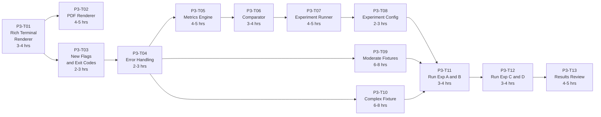

| Task ID | Title | Estimate | Depends On | Status |
|---------|-------|----------|------------|--------|
| P3-T01 | Rich Terminal Renderer | 3–4 hrs | P2-T10 | To Do |
| P3-T02 | PDF Renderer | 4–5 hrs | P3-T01 | To Do |
| P3-T03 | New Flags and Exit Codes | 2–3 hrs | P2-T10 | To Do |
| P3-T04 | Error Handling Hardening | 2–3 hrs | P3-T03 | To Do |
| P3-T05 | Metrics Engine | 4–5 hrs | P3-T04 | To Do |
| P3-T06 | Comparator | 3–4 hrs | P3-T05 | To Do |
| P3-T07 | Experiment Runner | 4–5 hrs | P3-T06 | To Do |
| P3-T08 | Experiment Configuration Files | 2–3 hrs | P3-T07 | To Do |
| P3-T09 | Moderate Tier Test Fixtures | 6–8 hrs | P3-T04 | To Do |
| P3-T10 | Complex Tier Fixture | 6–8 hrs | P3-T09 | To Do |
| P3-T11 | Run Experiments A and B | 3–4 hrs | P3-T08, P3-T09, P3-T10 | To Do |
| P3-T12 | Run Experiments C and D | 3–4 hrs | P3-T11 | To Do |
| P3-T13 | Results Review and Targeted Re-run | 4–5 hrs | P3-T11, P3-T12 | To Do |
| | **Total Estimate** | **48–63 hrs** | | |

---

## 10. Full Experiment Run Plan

The table below summarises the complete experiment execution plan for Phase 3, including the scenario coverage, LLM cost estimate, and expected run time.

| Experiment | Scenarios | Repeats | Temp | LLM Calls | Est. Cost (GPT-4o) | Est. Duration |
|-----------|----------|---------|------|-----------|-------------------|--------------|
| A — IaC Only | 11 (all tiers) | 1 | 0.5 | 11 | ~$0.50 | 10–15 min |
| B — Multi-Source | 11 (all tiers) | 1 | 0.5 | 11 | ~$0.80 | 12–18 min |
| C — Reliability | MOD-01 only | 10 | 0.5 | 10 | ~$0.40 | 8–12 min |
| D — Temperature | MOD-01 only | 5 × 3 temps | 0.0, 0.5, 1.0 | 15 | ~$0.60 | 12–18 min |
| **Total** | | **37 calls** | | | **~$2.30** | **~50–60 min** |

> Cost estimates based on GPT-4o pricing at approximately $5/M input tokens and $15/M output tokens, with average prompt size of ~4,500 tokens and average output of ~800 tokens per call. Actual cost will vary.

### Experiment Execution Order

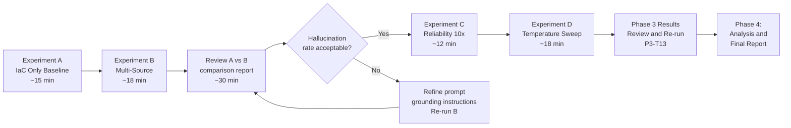

---

## 11. Technical Risks and Mitigations

| Risk | Likelihood | Impact | Mitigation |
|------|-----------|--------|-----------|
| Experiment runs exceed LLM API rate limits, causing partial failures mid-run | Medium | Medium | Runner implements per-scenario rate limit detection with automatic 60-second backoff. Failed scenarios are re-queued at the end of the run rather than aborting. |
| Ground-truth files for moderate and complex tiers are incomplete or incorrectly structured, causing comparator errors | Medium | High | Add a ground-truth validation step to the runner: before starting the experiment, validate all `ground_truth.json` files against the schema. Fail fast with a clear error if any are malformed. |
| ReportLab PDF renderer produces layout errors (content overflow, font issues) on some platforms | Low | Low | Scope the PDF renderer to text-only output (no images or complex layouts). Use only built-in ReportLab fonts. Test on both Linux and macOS. |
| Jaccard Index falls below 0.70 at all temperatures, indicating the model is fundamentally inconsistent on this prompt design | Low | High | If J < 0.70 even at temperature 0.0, investigate whether the threat schema is too open-ended. Consider switching to a two-pass approach: first ask for components at risk, then ask for threats per component. This gives the model a more constrained output space. |
| Complex-tier fixture (COMP-01) produces recall < 0.50, making results uninterpretable | Medium | Medium | This is expected and acceptable as a finding — the report will document where the tool's capability ceiling lies. It does not need to pass all complexity tiers to be a useful research result. |
| Phase 3 experiments consume budget before all runs complete | Low | Medium | Set `--provider ollama` as a fallback for Experiments C and D (reliability testing) where the same model must be used consistently — Ollama provides free, unlimited local runs and is sufficient for consistency measurement. |

---

*Document end. Phase 4 (Analysis, Write-Up, and Final Report) to follow.*
