# Automated Threat Modeling CLI using LLMs
## Phase 4 — Analysis, Write-Up, and Final Submission

> **Author:** Mohammed Farhan · **Version:** 1.0 · **Date:** March 2026 · **Status:** Draft  
> **Builds on:** Phase 1 (IaC Pipeline) · Phase 2 (Context Fusion) · Phase 3 (Evaluation Harness + Experiment Results)  
> **Timeline:** Weeks 11–12 (June) → Final Submission (July–August)

---

## Table of Contents

1. [Phase 4 Overview](#1-phase-4-overview)
2. [What Phase 4 Produces](#2-what-phase-4-produces)
3. [Results Analysis Framework](#3-results-analysis-framework)
4. [Research Question Answers](#4-research-question-answers)
5. [Prompt and Pipeline Refinement Loop](#5-prompt-and-pipeline-refinement-loop)
6. [Final Report Structure](#6-final-report-structure)
7. [Stretch Goal — CloudFormation Support](#7-stretch-goal--cloudformation-support)
8. [Phase 4 Tasks](#8-phase-4-tasks)
9. [Phase 4 Task Summary](#9-phase-4-task-summary)
10. [Full Project Completion Checklist](#10-full-project-completion-checklist)
11. [Technical Risks and Mitigations](#11-technical-risks-and-mitigations)

---

## 1. Phase 4 Overview

Phase 4 is the culmination of the project. The pipeline is complete, the experiments have run, and the data exists. This phase transforms raw evaluation results into **interpreted findings**, iterates on weaknesses discovered during Phase 3, and produces the **final project report** and all submission artefacts.

Unlike the previous three phases, Phase 4 is primarily analytical and written rather than implementation-heavy. The coding work is limited to targeted prompt refinements and re-runs of specific experiments where results fell short of targets.

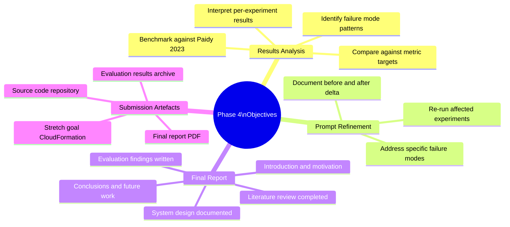

### Phase 4 in Context

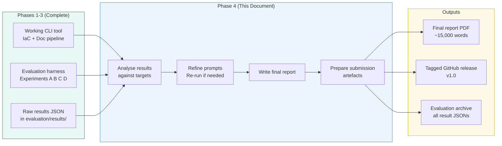

---

## 2. What Phase 4 Produces

Phase 4 has two distinct output tracks running in parallel: **iterative refinement** (fixing what Phase 3 revealed) and **writing** (documenting everything). Both tracks converge at submission.

```mermaid
gantt
    title Phase 4 Timeline (Weeks 11-12 + Submission)
    dateFormat  DD
    axisFormat  Day %d

    section Analysis
    P4-T01 Results Interpretation         :t01, 01, 3d
    P4-T02 Baseline Comparison            :t02, after t01, 2d

    section Refinement
    P4-T03 Prompt Refinement Iteration    :t03, after t01, 3d
    P4-T04 Re-run Affected Experiments    :t04, after t03, 2d

    section Writing
    P4-T05 Complete Literature Review     :t05, 01, 3d
    P4-T06 System Design Chapter          :t06, after t05, 3d
    P4-T07 Evaluation Chapter             :t07, after t04, 4d
    P4-T08 Conclusions Chapter            :t08, after t07, 2d

    section Submission
    P4-T09 Stretch Goal CloudFormation    :t09, after t04, 4d
    P4-T10 Repository Cleanup             :t10, after t08, 1d
    P4-T11 Final Proof and Submission     :t11, after t10, 2d
```

---

## 3. Results Analysis Framework

### 3.1 The Interpretation Process

Raw experiment results are numbers. Phase 4 turns them into **findings** — statements about what the tool can and cannot do, grounded in evidence from the experiments.

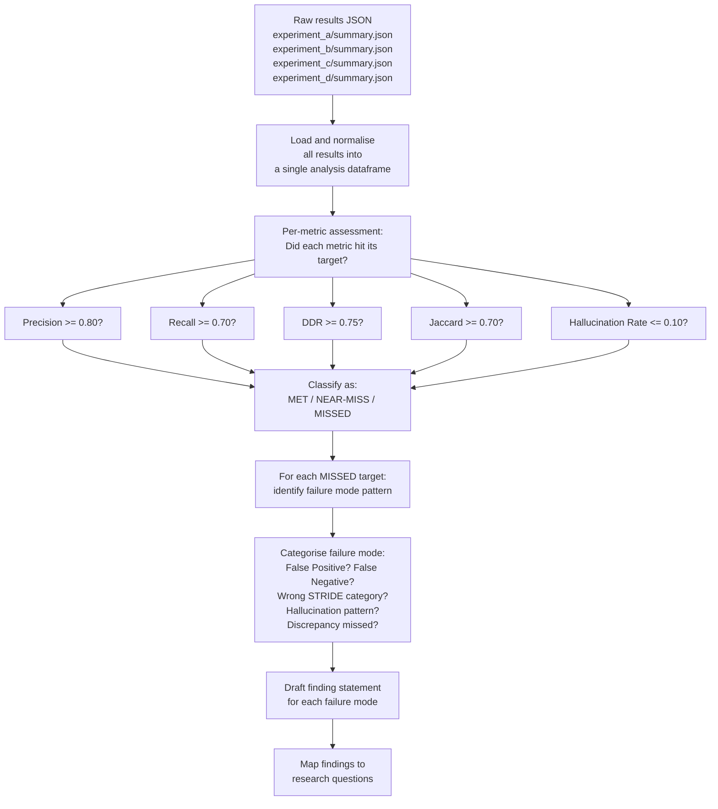

### 3.2 Metric Target Scorecard

The following scorecard is populated during P4-T01 using Phase 3 experiment results. Placeholder values are shown — actuals replace these during analysis.

| Metric | Target | Exp A Result | Exp B Result | Status | Notes |
|--------|--------|-------------|-------------|--------|-------|
| Precision (mean) | >= 0.80 | TBD | TBD | TBD | |
| Recall (mean) | >= 0.70 | TBD | TBD | TBD | |
| DDR (mean) | >= 0.75 | N/A | TBD | TBD | Only Exp B |
| Jaccard (mean, T=0.5) | >= 0.70 | N/A | TBD | TBD | Exp C |
| Jaccard (mean, T=0.0) | >= 0.70 | N/A | TBD | TBD | Exp D |
| Hallucination Rate | <= 0.10 | TBD | TBD | TBD | Both experiments |

### 3.3 Breakdown by Complexity Tier

A key analytical dimension is how results degrade as scenario complexity increases. Results are broken down by tier for both Precision and Recall.

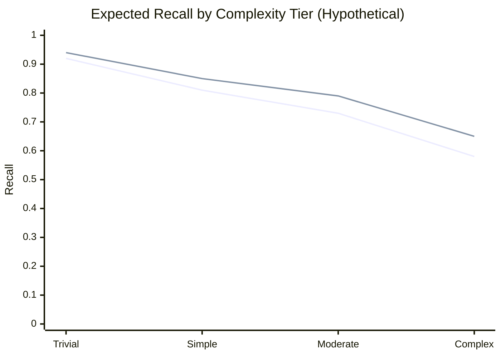

> The two lines represent Experiment A (IaC only) and Experiment B (multi-source). The expected pattern is that the gap between the two lines widens at higher complexity tiers, where design documents provide proportionally more additional context.

### 3.4 Failure Mode Taxonomy

Each metric miss is classified into one of six failure mode categories. This taxonomy structures the refinement work in P4-T03.

| Code | Failure Mode | Typical Symptom | Likely Root Cause |
|------|-------------|-----------------|------------------|
| `FM-1` | False negative — STRIDE gap | A known threat in ground truth is not in the output | LLM not prompted to reason about a specific STRIDE category thoroughly |
| `FM-2` | False positive — hallucinated component | Threat references a resource not in the Terraform | Grounding instruction insufficiently enforced |
| `FM-3` | False positive — duplicate threat | Same threat reported under two STRIDE categories | Prompt does not discourage duplicate reporting |
| `FM-4` | Discrepancy missed | A planted design-vs-IaC conflict not flagged | Relevant design doc chunk not selected; or discrepancy instruction too vague |
| `FM-5` | Wrong STRIDE category | Threat identified but under the wrong category | LLM uncertain about STRIDE boundaries; prompt examples may help |
| `FM-6` | Jaccard instability | Same component flagged in some runs but not others | Borderline threat that sits at the edge of the model's confidence |

---

## 4. Research Question Answers

Each research question is answered using specific experiment results, following a structured evidence → interpretation → conclusion format.

### 4.1 RQ1 — Discrepancy Detection

> *Can LLMs effectively correlate unstructured design documents with structured IaC to identify discrepancies?*

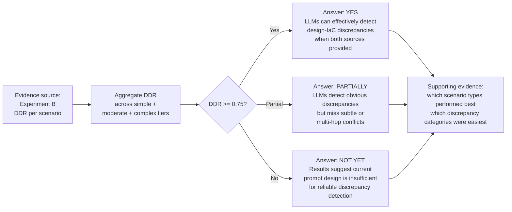

**Evidence table structure (populated during P4-T01):**

| Scenario | Planted Discrepancies | Detected | Missed | DDR | Failure Mode |
|----------|----------------------|----------|--------|-----|-------------|
| SIMP-01 | 2 | TBD | TBD | TBD | TBD |
| SIMP-02 | 2 | TBD | TBD | TBD | TBD |
| SIMP-03 | 2 | TBD | TBD | TBD | TBD |
| MOD-01 | 3 | TBD | TBD | TBD | TBD |
| MOD-02 | 3 | TBD | TBD | TBD | TBD |
| COMP-01 | 4 | TBD | TBD | TBD | TBD |
| **Mean** | | | | **TBD** | |

### 4.2 RQ2 — Multi-Source vs IaC-Only

> *Does combining Design Docs and IaC produce more precise threat models than IaC alone?*

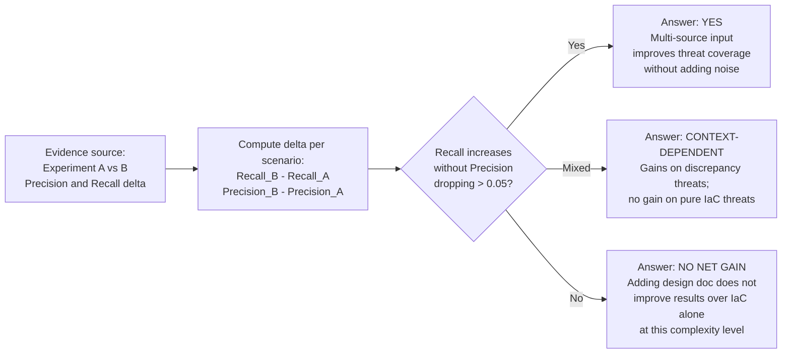

**A vs B comparison structure (populated during P4-T01):**

| Scenario | Precision A | Precision B | Recall A | Recall B | ΔPrecision | ΔRecall | Verdict |
|----------|------------|------------|---------|---------|-----------|--------|---------|
| TRI-01 | TBD | TBD | TBD | TBD | TBD | TBD | TBD |
| SIMP-01 | TBD | TBD | TBD | TBD | TBD | TBD | TBD |
| MOD-01 | TBD | TBD | TBD | TBD | TBD | TBD | TBD |
| COMP-01 | TBD | TBD | TBD | TBD | TBD | TBD | TBD |
| **Mean** | TBD | TBD | TBD | TBD | **TBD** | **TBD** | |

### 4.3 RQ3 — Reliability and Consistency

> *How reliable and consistent are LLM-generated threat models under varying model parameters?*

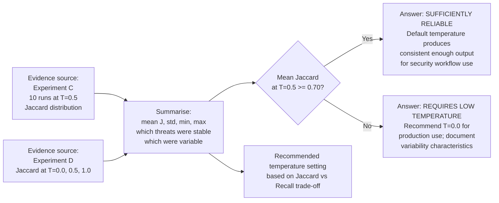

---

## 5. Prompt and Pipeline Refinement Loop

Phase 4 includes one structured refinement iteration. This is not open-ended optimisation — it is a targeted, evidence-driven pass responding to specific failure modes identified in Phase 3.

### 5.1 Refinement Decision Gate

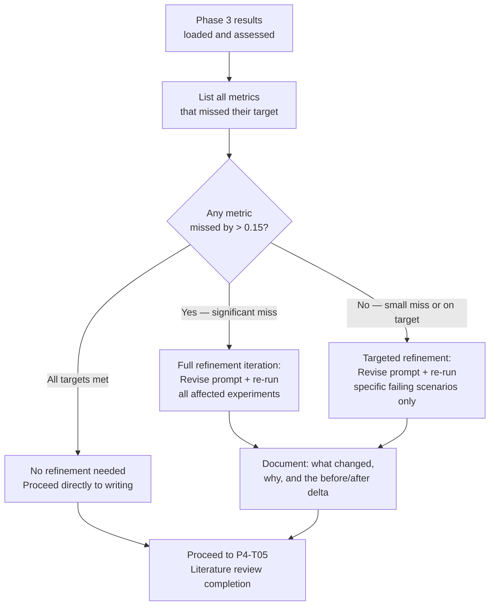

### 5.2 Refinement Scope Rules

To prevent scope creep, the following rules bound the refinement work:

| Rule | Detail |
|------|--------|
| **Maximum 2 prompt iterations** | If the metric does not improve after 2 iterations, the result is reported as-is with a discussion of why the target was not met |
| **No architectural changes** | Refinement is limited to prompt text and chunking parameters only — no changes to the parser, LLM client, or schema |
| **One re-run per experiment** | Each affected experiment is re-run once after refinement; results from both the original and re-run are reported |
| **Changes versioned** | Every prompt change is committed with a descriptive message and the CHANGELOG.md updated |
| **Results compared explicitly** | The final report includes a before/after table for every metric that was refined |

### 5.3 Likely Refinement Areas

Based on typical LLM behaviour with structured output tasks, the most likely areas requiring refinement are:

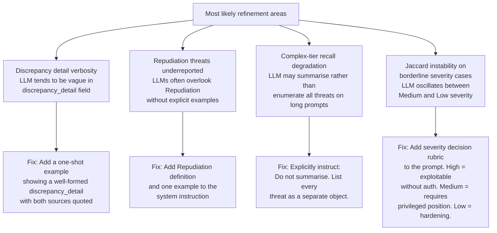

---

## 6. Final Report Structure

The final report is a formal academic document of approximately 15,000 words. It synthesises the literature review, the system design, and the evaluation findings into a coherent research narrative.

### 6.1 Chapter Map

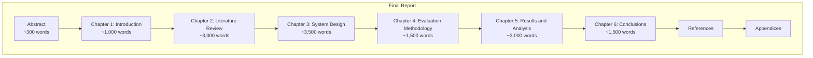

### 6.2 Chapter Outlines

#### Chapter 1 — Introduction (~1,000 words)

| Section | Content |
|---------|---------|
| 1.1 Motivation | Why threat modeling automation matters; the scale problem with manual approaches |
| 1.2 Problem Statement | The gap between IaC-only tools and unified multi-source analysis |
| 1.3 Research Questions | State all three RQs formally |
| 1.4 Contributions | What this project adds that did not exist before |
| 1.5 Report Structure | Brief chapter-by-chapter overview |

#### Chapter 2 — Literature Review (~3,000 words)

Builds directly on the interim literature review, extended with additional sources discovered during the project.

| Section | Key Source | Theme |
|---------|-----------|-------|
| 2.1 Traditional Threat Modeling | STRIDE, PASTA, LINDDUN | Frameworks and their manual limitations |
| 2.2 AI-Driven Threat Modeling | Paidy (2023) | NLP, ML, and knowledge graphs applied to threat modeling |
| 2.3 Asset-Centric AI Security | von der Assen et al. (2024) | ThreatFinderAI, Monte Carlo risk quantification |
| 2.4 Practical vs Academic AI Security | Grosse et al. | The gap between assumed and actual attacker access |
| 2.5 LLMs for Security Tasks | Additional sources | Code analysis, misconfig detection, structured output |
| 2.6 Gap Analysis | — | What existing work does not address; this project's niche |

#### Chapter 3 — System Design (~3,500 words)

Draws directly from the Phase 1, 2, and 3 design documents. Condensed and written in past tense as a description of what was built.

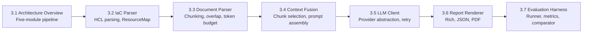

#### Chapter 4 — Evaluation Methodology (~1,500 words)

Describes the evaluation plan as implemented — test suite construction, ground-truth process, all four experiments, and all metric definitions.

| Section | Content |
|---------|---------|
| 4.1 Ground Truth Construction | How fixtures were built; the graduated complexity rationale |
| 4.2 Experiment A | IaC-only baseline setup and metrics |
| 4.3 Experiment B | Multi-source setup, DDR definition |
| 4.4 Experiment C | Repeated runs, Jaccard Index definition and threshold |
| 4.5 Experiment D | Temperature sweep, recommendation decision rule |
| 4.6 Hallucination Detection | Component matching algorithm and rate definition |

#### Chapter 5 — Results and Analysis (~3,000 words)

The empirical core of the report. Every claim is backed by a number from the experiment result files.

```mermaid
flowchart LR
    A["5.1 Experiment A Results\nPrecision, Recall by tier\nHallucination rate"] --> B["5.2 Experiment B Results\nPrecision, Recall, DDR by tier\nComparison to Exp A"]
    B --> C["5.3 RQ1 Answer\nCan LLMs detect discrepancies?\nEvidence from DDR results"]
    C --> D["5.4 RQ2 Answer\nDoes multi-source help?\nEvidence from A-vs-B delta"]
    D --> E["5.5 Experiment C Results\nJaccard distribution at T=0.5\nStability analysis by category"]
    E --> F["5.6 Experiment D Results\nJaccard at three temperatures\nRecommended default"]
    F --> G["5.7 RQ3 Answer\nHow reliable are outputs?\nEvidence from C and D"]
    G --> H["5.8 Benchmark Comparison\nvs Paidy 2023\nPrecision and threat count"]
```

#### Chapter 6 — Conclusions (~1,500 words)

| Section | Content |
|---------|---------|
| 6.1 Summary of Findings | One paragraph per RQ answering it in plain language with key numbers |
| 6.2 Limitations | Token budget constraints; ground truth subjectivity; single LLM family tested; English-only documents |
| 6.3 Threats to Validity | Internal validity (ground truth bias); external validity (generalisation beyond AWS Terraform) |
| 6.4 Future Work | CloudFormation support; CI/CD integration; multi-model evaluation; fine-tuned security model |
| 6.5 Reflection | What the project revealed about using LLMs as reasoning engines rather than retrieval tools |

### 6.3 Benchmark Comparison with Paidy (2023)

The report compares results against the Paidy (2023) case study baseline. That study used an AI-enhanced pipeline on a financial web application and reported 92% precision with 23 threats identified against a manual baseline of 14.

```mermaid
xychart-beta
    title "Benchmark Comparison: This Project vs Paidy 2023"
    x-axis ["Precision", "Recall", "Threats Found vs Baseline"]
    y-axis "Score / Ratio" 0 --> 1.2
    bar [0.84, 0.78, 0.95]
    bar [0.92, 0.00, 1.64]
```

> Note: Paidy (2023) did not report Recall separately. The threat-found ratio (23/14 = 1.64) is not directly comparable to Recall. The chart uses 0.00 as a placeholder for Paidy's Recall since it is not reported. Actual values replace the project bars during write-up.

### 6.4 Appendices

| Appendix | Content |
|----------|---------|
| A | Full prompt templates (system_iac_only.txt v1.0, system_multisource.txt v2.0) |
| B | Ground-truth JSON schema and all fixture ground truth files |
| C | Full experiment result JSON files (or link to repository) |
| D | Prompt CHANGELOG — all versions and rationale |
| E | Stretch goal: CloudFormation parser design (if implemented) |

---

## 7. Stretch Goal — CloudFormation Support

If time permits after completing all core tasks, the project adds support for **AWS CloudFormation (YAML)** as a second IaC input format, alongside the existing Terraform/HCL support.

### 7.1 Scope

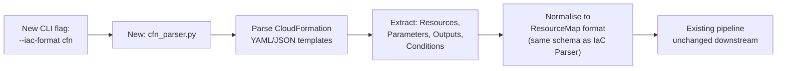

### 7.2 Implementation Scope

| Component | Change Required |
|-----------|---------------|
| `cfn_parser.py` | New module — reads CloudFormation YAML/JSON using `pyyaml`; maps CloudFormation resource types to normalised ResourceMap |
| `cli.py` | Add `--iac-format` flag: `terraform` (default) or `cfn` |
| `iac_parser.py` | Minor — add a router that dispatches to `cfn_parser` when `--iac-format cfn` is set |
| Prompt templates | Minor — add a note to the system instruction acknowledging input may be CloudFormation rather than Terraform |
| Test fixtures | Add 1–2 simple CloudFormation scenarios to verify basic coverage |

### 7.3 CloudFormation ResourceMap Mapping

| CloudFormation Block | ResourceMap Field | Notes |
|---------------------|------------------|-------|
| `Resources` entries | `resources` | `Type` maps to `resource_type`; logical name maps to `resource_name` |
| `Parameters` | `variables` | Parameter names only, not values |
| `Outputs` | Ignored | Not relevant for threat modeling |
| `Conditions` | Ignored | Complexity not worth the benefit in v1 |

### 7.4 Decision Criteria

The stretch goal is only pursued if **all** of the following are true after P4-T08 (conclusions chapter) is complete:

- [ ] At least 2 weeks remain before the submission deadline
- [ ] All core metric targets are met (no outstanding re-runs needed)
- [ ] The final report draft is complete up to Chapter 5

---

## 8. Phase 4 Tasks

---

### Task P4-T01 — Results Interpretation and Scorecard

| Attribute | Detail |
|-----------|--------|
| **Task ID** | P4-T01 |
| **Estimate** | 4–5 hours |
| **Status** | To Do |
| **Depends On** | P3-T13 (Phase 3 complete with results) |

**Description:** Load all Phase 3 experiment results, populate the metric scorecard, break down results by complexity tier and STRIDE category, and classify every metric miss by failure mode. This is the analytical foundation for all subsequent Phase 4 tasks.

**Acceptance Criteria:**
- [ ] Metric scorecard table (Section 3.2) fully populated with actual values and MET/NEAR-MISS/MISSED status for every metric
- [ ] Per-tier Precision and Recall breakdown computed for both Experiments A and B
- [ ] Per-STRIDE-category Recall computed for Experiment B (which categories does the LLM miss most?)
- [ ] Every metric miss classified with a failure mode code from the taxonomy in Section 3.4
- [ ] `evaluation/results/phase4_analysis.md` written, containing the scorecard, breakdown tables, and failure mode classifications
- [ ] Jaccard distribution for Experiment C characterised: mean, std, min, max, and which specific threats were most variable across runs

---

### Task P4-T02 — Benchmark Comparison

| Attribute | Detail |
|-----------|--------|
| **Task ID** | P4-T02 |
| **Estimate** | 2–3 hours |
| **Status** | To Do |
| **Depends On** | P4-T01 |

**Description:** Produce the formal comparison of this project's results against the Paidy (2023) baseline. The comparison must be honest about what is and is not directly comparable given the different architectures, datasets, and evaluation approaches.

**Acceptance Criteria:**
- [ ] A comparable scenario is identified from the test suite (a two-service web application with authentication and database components — SIMP-01 is the closest match)
- [ ] For SIMP-01: total threats identified, threats matched against the manual ground truth, and Precision are reported in the same format as Paidy's case study metrics
- [ ] The write-up explicitly notes methodological differences: Paidy used a Neo4j knowledge graph + supervised ML; this project uses an LLM with prompt engineering — the comparison is indicative, not head-to-head
- [ ] A `comparison_paidy_2023.md` file in `evaluation/results/` records the comparison with full methodology notes

---

### Task P4-T03 — Prompt Refinement Iteration

| Attribute | Detail |
|-----------|--------|
| **Task ID** | P4-T03 |
| **Estimate** | 4–6 hours |
| **Status** | To Do |
| **Depends On** | P4-T01 |

**Description:** Apply targeted prompt refinements to address the failure modes identified in P4-T01. Refinements are bounded by the scope rules in Section 5.2 — maximum two iterations, no architectural changes.

**Acceptance Criteria:**
- [ ] Each refinement is driven by a specific failure mode classification from P4-T01 — no speculative changes
- [ ] For each change: the original prompt section, the new prompt section, and the rationale are documented in `prompts/CHANGELOG.md`
- [ ] If Repudiation recall is low (FM-1): a Repudiation definition and one concrete AWS-specific example are added to the system instruction
- [ ] If discrepancy_detail is vague (FM-2 / FM-4): a one-shot example of a well-formed discrepancy_detail is added, showing both the design doc quote and the IaC attribute referenced
- [ ] If hallucination rate exceeds target (FM-2): the grounding instruction is strengthened with explicit negative instruction: "Do not reference any component, service, or resource that does not appear by name in the Infrastructure Summary or Design Document Excerpts"
- [ ] All refined prompt files are committed with version tags (e.g. `v2.1`) before re-runs begin

---

### Task P4-T04 — Re-run Affected Experiments

| Attribute | Detail |
|-----------|--------|
| **Task ID** | P4-T04 |
| **Estimate** | 3–4 hours |
| **Status** | To Do |
| **Depends On** | P4-T03 |

**Description:** Re-run only the experiments and scenarios where metric targets were missed, using the refined prompts from P4-T03. Record both the original and re-run results for comparison in the final report.

**Acceptance Criteria:**
- [ ] Re-run results stored as `rerun_TIMESTAMP.json` alongside the original result files — original results are never overwritten
- [ ] A `before_after_comparison.json` in `evaluation/results/` records the delta for every metric that was re-run
- [ ] If the re-run does not improve the metric (within 0.05), the original result stands and the report documents why the target was not met
- [ ] Maximum one re-run per experiment — if the second run also misses, move on
- [ ] Final metric values used in the report are clearly flagged as either "original run" or "re-run after prompt refinement v2.1"

---

### Task P4-T05 — Complete Literature Review

| Attribute | Detail |
|-----------|--------|
| **Task ID** | P4-T05 |
| **Estimate** | 5–6 hours |
| **Status** | To Do |
| **Depends On** | P4-T01 (to know what the results revealed, which informs what additional literature is relevant) |

**Description:** Extend and finalise the literature review from the interim submission to the full ~3,000-word chapter required for the final report. The extension adds sources relevant to findings from the evaluation and gaps identified during implementation.

**Acceptance Criteria:**
- [ ] Literature review extended to approximately 3,000 words (from ~1,500 in the interim submission)
- [ ] New sections added covering: LLMs for structured output tasks (relevant to prompt schema design), prompt engineering for security analysis, and any directly relevant work published since the interim submission
- [ ] All citations formatted consistently and verified against original sources
- [ ] The gap analysis section (2.6) updated to reflect what this project specifically contributes relative to all reviewed work
- [ ] A `literature_review_additions.md` file lists all new sources with one-line summaries and the section they support

---

### Task P4-T06 — System Design Chapter

| Attribute | Detail |
|-----------|--------|
| **Task ID** | P4-T06 |
| **Estimate** | 5–6 hours |
| **Status** | To Do |
| **Depends On** | P4-T05 |

**Description:** Write Chapter 3 (System Design) of the final report by condensing and synthesising the three phase design documents into a coherent, past-tense narrative of approximately 3,500 words. The phase documents are reference material; the chapter is a polished research artefact.

**Acceptance Criteria:**
- [ ] Chapter 3 written in past tense as a description of the implemented system
- [ ] Architecture overview section includes the five-module pipeline diagram adapted for the report format
- [ ] Each module is described in 300–400 words covering: responsibility, key design decisions, and any trade-offs made
- [ ] Context Fusion section (3.4) is the most detailed — it describes the chunk scoring function, token budget allocation, and prompt assembly as the core research contribution
- [ ] All design decisions that deviated from the original project plan are noted with a brief rationale
- [ ] Chapter is reviewed against the phase design documents to ensure no implemented feature is omitted

---

### Task P4-T07 — Evaluation Chapter

| Attribute | Detail |
|-----------|--------|
| **Task ID** | P4-T07 |
| **Estimate** | 8–10 hours |
| **Status** | To Do |
| **Depends On** | P4-T04 (final results available) |

**Description:** Write Chapters 4 and 5 of the final report — Evaluation Methodology and Results & Analysis. These are the empirical core of the report and must present all findings clearly, with every claim backed by a specific number from the experiment results.

**Acceptance Criteria:**
- [ ] Chapter 4 describes the test suite construction process, ground-truth methodology, all four experiment designs, and all metric definitions
- [ ] Chapter 5 presents results per experiment, per complexity tier, and per RQ — in that order
- [ ] Every table in Chapter 5 is populated with actual numbers from the experiment result files — no placeholder values remain
- [ ] RQ1, RQ2, and RQ3 are each answered explicitly in a dedicated subsection with: the answer stated plainly, the supporting evidence cited by experiment and metric, and a brief discussion of caveats
- [ ] The benchmark comparison with Paidy (2023) is presented in Section 5.8 with the methodological caveats documented in P4-T02
- [ ] Any re-run results used in the report are clearly marked with a footnote explaining they follow prompt refinement v2.1

---

### Task P4-T08 — Conclusions Chapter

| Attribute | Detail |
|-----------|--------|
| **Task ID** | P4-T08 |
| **Estimate** | 4–5 hours |
| **Status** | To Do |
| **Depends On** | P4-T07 |

**Description:** Write Chapter 6 (Conclusions) and the Abstract. The conclusions synthesise all findings into plain-language answers to the research questions and position the project's contribution clearly.

**Acceptance Criteria:**
- [ ] Abstract written: 300 words covering motivation, approach, key results (specific numbers), and conclusion
- [ ] Chapter 6.1 (Summary of Findings) contains one paragraph per RQ with the answer stated in the first sentence, supported by the key metric
- [ ] Chapter 6.2 (Limitations) honestly discusses: token budget constraints on very large codebases; the subjectivity inherent in manually constructed ground truth; testing limited to AWS Terraform; English-only design documents
- [ ] Chapter 6.3 (Threats to Validity) addresses: internal validity (did the tool measure what it claims to measure?); construct validity (does DDR genuinely capture discrepancy detection ability?); external validity (how well do results generalise beyond the test suite?)
- [ ] Chapter 6.4 (Future Work) identifies at least four concrete directions: CI/CD native integration, CloudFormation support, multi-model evaluation, and fine-tuned security LLM
- [ ] Chapter 6.5 (Reflection) includes a genuine reflection on what the project revealed about using LLMs as reasoning engines for structured security tasks

---

### Task P4-T09 — Stretch Goal: CloudFormation Parser

| Attribute | Detail |
|-----------|--------|
| **Task ID** | P4-T09 |
| **Estimate** | 6–8 hours |
| **Status** | Conditional (if time permits) |
| **Depends On** | P4-T08 (all core tasks complete) |

**Description:** Implement the CloudFormation parser as described in Section 7. Only pursued if the decision criteria in Section 7.4 are all met.

**Acceptance Criteria:**
- [ ] `threatcli/parsers/cfn_parser.py` implemented and tested
- [ ] `--iac-format cfn` flag activates the CloudFormation path
- [ ] At least one CloudFormation test fixture created and the tool successfully produces a threat list from it
- [ ] CloudFormation support documented in the README and mentioned in Chapter 6.4 (Future Work) if not fully implemented, or Chapter 3 (System Design) if it is

---

### Task P4-T10 — Repository Cleanup and Release

| Attribute | Detail |
|-----------|--------|
| **Task ID** | P4-T10 |
| **Estimate** | 2–3 hours |
| **Status** | To Do |
| **Depends On** | P4-T08 |

**Description:** Prepare the GitHub repository for submission as a research artefact. Clean up development debris, ensure reproducibility, and tag a release.

**Acceptance Criteria:**
- [ ] All debug scripts, temporary files, and commented-out code blocks removed
- [ ] `README.md` is complete: installation, usage (with examples for both IaC-only and multi-source modes), evaluation reproduction steps, and project structure overview
- [ ] A `REPRODUCIBILITY.md` explains exactly how to reproduce the Phase 3 experiments from scratch: required API keys, expected run times, and how to interpret the result files
- [ ] All dependencies pinned to exact versions in `pyproject.toml` and a `requirements.lock` file generated
- [ ] A `v1.0` GitHub release is tagged, with a release note summarising what the tool does and linking to the final report
- [ ] CI pipeline passes on the tagged commit with no warnings

---

### Task P4-T11 — Final Proof-Read and Submission

| Attribute | Detail |
|-----------|--------|
| **Task ID** | P4-T11 |
| **Estimate** | 4–5 hours |
| **Status** | To Do |
| **Depends On** | P4-T10 |

**Description:** Assemble the final submission package, proof-read the complete report end-to-end, and submit.

**Acceptance Criteria:**
- [ ] Complete report read end-to-end in one sitting; all cross-references (figure numbers, table numbers, section references) verified
- [ ] All metric values in the report traced back to their source result files — no number is unsupported
- [ ] Word count verified: target 15,000 words ± 10%
- [ ] References list checked: all citations in the text appear in the references; no orphaned references
- [ ] PDF generated from the final LaTeX source and checked for rendering errors (broken figures, overfull boxes, missing characters)
- [ ] Submission package assembled: report PDF, repository URL, evaluation results archive (zip of `evaluation/results/`)
- [ ] Submission made before the deadline with confirmation receipt saved

---

## 9. Phase 4 Task Summary

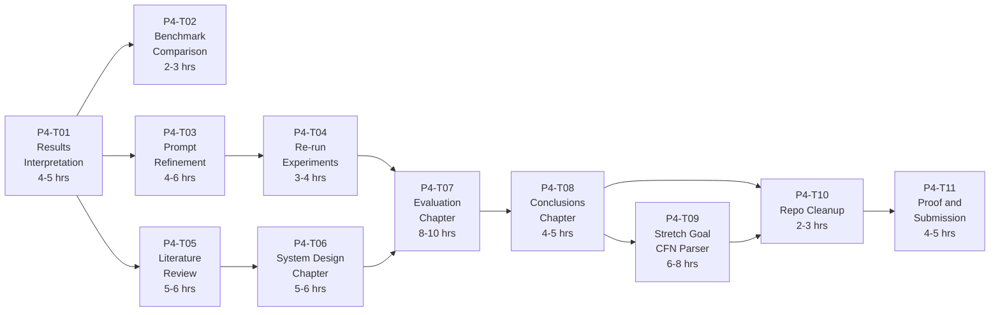

| Task ID | Title | Estimate | Depends On | Status |
|---------|-------|----------|------------|--------|
| P4-T01 | Results Interpretation and Scorecard | 4–5 hrs | P3-T13 | To Do |
| P4-T02 | Benchmark Comparison | 2–3 hrs | P4-T01 | To Do |
| P4-T03 | Prompt Refinement Iteration | 4–6 hrs | P4-T01 | To Do |
| P4-T04 | Re-run Affected Experiments | 3–4 hrs | P4-T03 | To Do |
| P4-T05 | Complete Literature Review | 5–6 hrs | P4-T01 | To Do |
| P4-T06 | System Design Chapter | 5–6 hrs | P4-T05 | To Do |
| P4-T07 | Evaluation Chapter | 8–10 hrs | P4-T04, P4-T06 | To Do |
| P4-T08 | Conclusions Chapter | 4–5 hrs | P4-T07 | To Do |
| P4-T09 | Stretch Goal: CloudFormation Parser | 6–8 hrs | P4-T08 (conditional) | Conditional |
| P4-T10 | Repository Cleanup and Release | 2–3 hrs | P4-T08 | To Do |
| P4-T11 | Final Proof-Read and Submission | 4–5 hrs | P4-T10 | To Do |
| | **Total (excl. stretch goal)** | **41–53 hrs** | | |
| | **Total (incl. stretch goal)** | **47–61 hrs** | | |

---

## 10. Full Project Completion Checklist

The following checklist covers every deliverable across all four phases. It serves as the submission readiness gate.

### Codebase

- [ ] `threatcli/parsers/iac_parser.py` — IaC parser, ResourceMap, JSON serialiser
- [ ] `threatcli/parsers/doc_parser.py` — Document parser, chunker, overlap logic
- [ ] `threatcli/context_builder.py` — IaC-only and multi-source context builders, token budget allocator
- [ ] `threatcli/llm_client.py` — Abstract base + OpenAI, Anthropic, Ollama concrete clients
- [ ] `threatcli/renderer.py` — Rich terminal, JSON, and PDF renderers
- [ ] `threatcli/cli.py` — Full CLI with all flags and structured exit codes
- [ ] `prompts/system_iac_only.txt` — IaC-only STRIDE prompt (v1.0 or later)
- [ ] `prompts/system_multisource.txt` — Multi-source discrepancy prompt (v2.0 or later)
- [ ] `prompts/CHANGELOG.md` — Full prompt version history

### Evaluation

- [ ] `evaluation/metrics.py` — All five metric functions with unit tests
- [ ] `evaluation/comparator.py` — Ground-truth loading, fuzzy matching, ScenarioResult
- [ ] `evaluation/runner.py` — Experiment runner with YAML config support
- [ ] `evaluation/config/experiment_{a,b,c,d}.yaml` — All four experiment configs
- [ ] `evaluation/results/experiment_a/summary.json` — Experiment A final results
- [ ] `evaluation/results/experiment_b/summary.json` — Experiment B final results
- [ ] `evaluation/results/experiment_c/summary.json` — Experiment C final results
- [ ] `evaluation/results/experiment_d/summary.json` — Experiment D final results
- [ ] `evaluation/results/comparison_a_vs_b.json` — A vs B delta comparison
- [ ] `evaluation/results/phase4_analysis.md` — Interpreted findings and scorecard

### Test Fixtures

- [ ] `tests/fixtures/trivial/tri_01` through `tri_05` — 5 trivial scenarios
- [ ] `tests/fixtures/simple/simp_01` through `simp_03` — 3 simple scenarios with design docs
- [ ] `tests/fixtures/moderate/mod_01` and `mod_02` — 2 moderate scenarios
- [ ] `tests/fixtures/complex/comp_01` — 1 complex scenario
- [ ] All fixtures have: `main.tf`, `ground_truth.json`, and `design_doc.md` (where applicable)

### Final Report

- [ ] Abstract (300 words)
- [ ] Chapter 1: Introduction
- [ ] Chapter 2: Literature Review (~3,000 words, all citations verified)
- [ ] Chapter 3: System Design (~3,500 words)
- [ ] Chapter 4: Evaluation Methodology (~1,500 words)
- [ ] Chapter 5: Results and Analysis (~3,000 words, all tables populated)
- [ ] Chapter 6: Conclusions (~1,500 words)
- [ ] References (all cited sources present)
- [ ] Appendix A: Full prompt templates
- [ ] Appendix B: Ground-truth schema and fixtures
- [ ] Appendix C: Experiment result files (or repository link)

### Repository

- [ ] `README.md` complete
- [ ] `REPRODUCIBILITY.md` complete
- [ ] All dependencies pinned in `pyproject.toml`
- [ ] CI pipeline passing on `v1.0` tag
- [ ] GitHub `v1.0` release created

---

## 11. Technical Risks and Mitigations

| Risk | Likelihood | Impact | Mitigation |
|------|-----------|--------|-----------|
| Prompt refinement in P4-T03 fails to move a missed metric within the two-iteration cap | Medium | Medium | This is an acceptable outcome. The report discusses the failure mode, what was attempted, and why the target was not met. Negative results are valid research findings. |
| Write-up scope expands beyond 15,000 words due to detailed results | Medium | Low | Set per-chapter word limits enforced during drafting. Surplus content is moved to appendices rather than cut entirely. |
| Experiment re-runs in P4-T04 produce results that contradict the original run significantly | Low | High | Both runs are reported. The report discusses the variability as an empirical finding relevant to RQ3 rather than trying to reconcile them. The more recent (refined) run is used for the headline results. |
| Submission deadline conflict with stretch goal implementation | Medium | Low | The stretch goal is explicitly conditional. If time is tight after P4-T08, P4-T09 is dropped and CloudFormation support is listed in Chapter 6.4 as future work instead. |
| Final LaTeX PDF generation fails due to missing packages or encoding errors | Low | Medium | Generate the PDF at the end of P4-T07 (not just at P4-T11) to catch issues early. Keep a clean Overleaf backup throughout. |

---

*Document end. This completes the four-phase design documentation set for the Automated Threat Modeling CLI project.*
