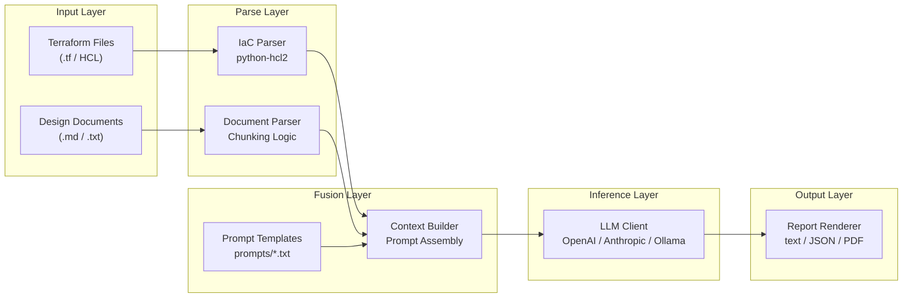
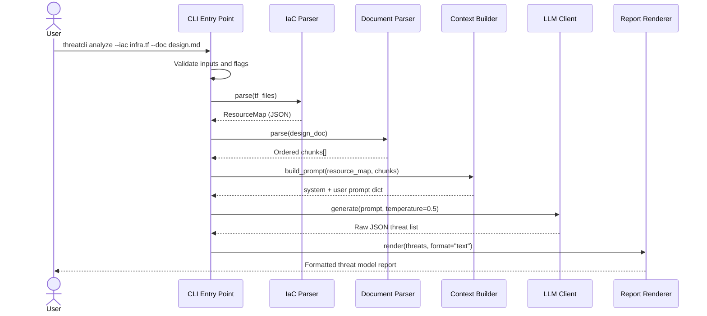
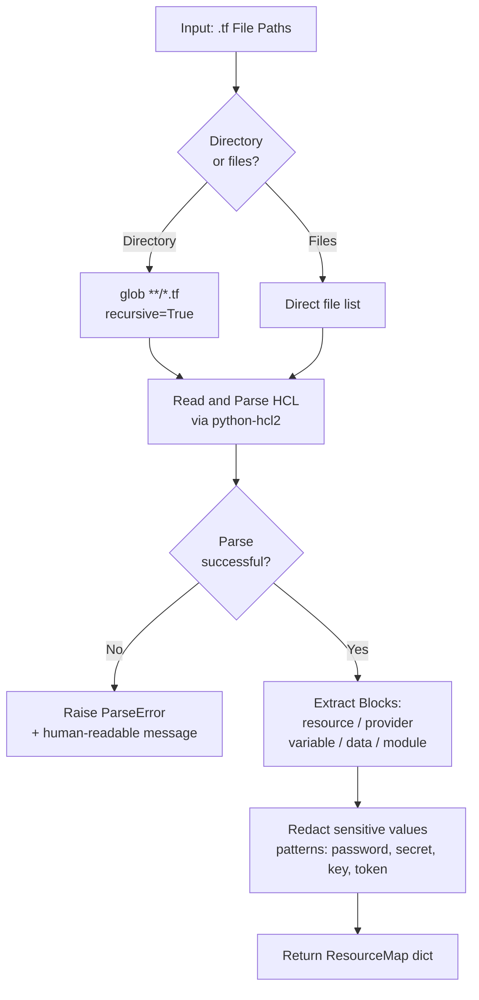
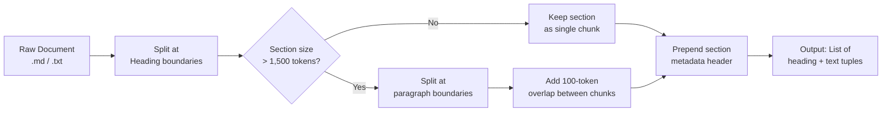
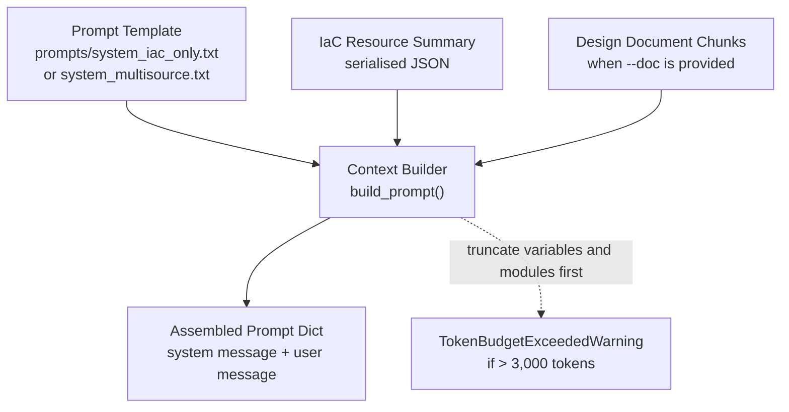
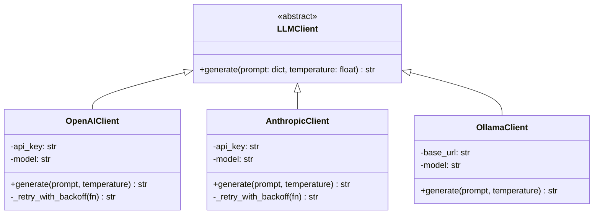
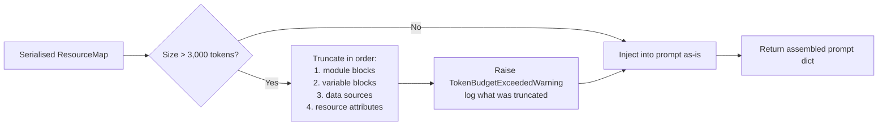
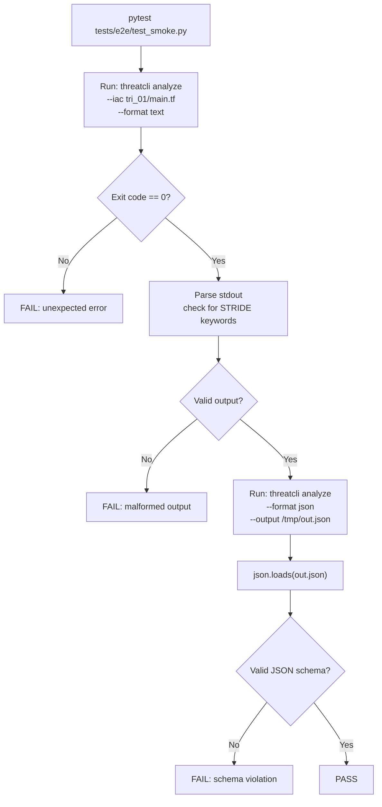
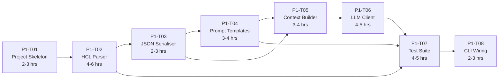

# Automated Threat Modeling CLI using LLMs
## System Design Document

> **Author:** Mohammed Farhan · **Version:** 1.0 · **Date:** March 2026 · **Status:** Draft

---

## Table of Contents

1. [Introduction](#1-introduction)
2. [System Overview](#2-system-overview)
   - 2.1 [High-Level Architecture](#21-high-level-architecture)
   - 2.2 [Data Flow](#22-data-flow)
   - 2.3 [Technology Stack](#23-technology-stack)
   - 2.4 [Design Decision Rationale](#24-design-decision-rationale)
3. [Module Design](#3-module-design)
4. [Threat Output Schema](#4-threat-output-schema)
5. [Phase 1 — Tasks](#5-phase-1--tasks)
6. [Phase 1 — Task Summary](#6-phase-1--task-summary)
7. [Technical Risks and Mitigations](#7-technical-risks-and-mitigations)
8. [Approach Comparison: LLM-Based vs. Agent-Based](#8-approach-comparison-llm-based-vs-agent-based-threat-modeling)

---

## 1. Introduction

### 1.1 Purpose

This document describes the system architecture and design of the **Automated Threat Modeling CLI** — a command-line tool that leverages Large Language Models (LLMs) to generate STRIDE-based threat models from Infrastructure-as-Code (IaC) files and Design Documents. It serves as the primary reference for development, testing, and evaluation throughout the project lifecycle.

### 1.2 Scope

The tool accepts Terraform (`.tf`) files and Markdown/text Design Documents as input. It processes these through an LLM backend to produce structured STRIDE threat reports. The system is designed to run as a standalone CLI and to be embeddable within CI/CD pipelines.

### 1.3 Definitions

| Term | Definition |
|------|-----------|
| **CLI** | Command-Line Interface |
| **IaC** | Infrastructure-as-Code — declarative config files (e.g. Terraform/HCL) defining cloud infrastructure |
| **LLM** | Large Language Model (e.g. GPT-4, Claude) used for NL understanding and generation |
| **STRIDE** | Spoofing, Tampering, Repudiation, Information Disclosure, Denial of Service, Elevation of Privilege |
| **HCL** | HashiCorp Configuration Language — the syntax used by Terraform |
| **Context Fusion** | Combining IaC summaries and design narrative into a single structured LLM prompt |
| **Chunking** | Splitting a large document into smaller segments to stay within LLM token limits |
| **Hallucination** | An LLM output referencing components not present in the provided input |

---

## 2. System Overview

### 2.1 High-Level Architecture

The system is composed of **five loosely coupled modules** forming a linear processing pipeline. Input artefacts are ingested, parsed, and fused into a structured prompt, which is sent to an LLM backend. The response is then parsed and rendered as a formatted threat report.



### 2.2 Data Flow



### 2.3 Technology Stack

| Layer | Technology | Rationale |
|-------|-----------|-----------|
| **Language** | Python 3.11+ | Strong ecosystem for CLI tooling, NLP, and LLM API clients |
| **CLI Framework** | Click / Typer | Declarative argument parsing, auto-generated help, testability |
| **IaC Parsing** | `python-hcl2` | Native HCL2 parser; outputs Python dicts |
| **Document Parsing** | `markdown-it-py` + stdlib | Lightweight Markdown parsing, no heavy dependencies |
| **LLM Backend** | OpenAI API / Anthropic API / Ollama | Pluggable; provider selected via config flag |
| **Output Rendering** | Rich (terminal) + json + ReportLab (PDF) | Progressive enhancement layered on top of plain JSON |
| **Testing** | `pytest` + `pytest-cov` | Standard Python testing; coverage reporting for CI |
| **Version Control** | Git + GitHub Actions | CI/CD hooks; automated test runs on every push |

### 2.4 Design Decision Rationale

This section documents the reasoning behind major architectural and technology choices, including alternatives considered and key trade-offs.

#### 2.4.1 LLM-Based Threat Generation vs. Alternatives

**Decision:** Use a single-shot LLM call to generate threats from fused context (IaC + design documents).

**Alternatives Considered:**

1. **Rules-based engine** — Hard-coded Terraform anti-patterns → threats
   - *Pros:* Deterministic, no API costs, fast, transparent output
   - *Cons:* Limited to known patterns; cannot reason about domain logic or design intent; does not scale to new threat types; high maintenance burden as IaC evolves
2. **Multi-step agent loop** — Agent iteratively queries knowledge base, refines IaC parsing, asks clarifying questions
   - *Pros:* Flexible, can handle ambiguity, transparent reasoning chain
   - *Cons:* High latency (5–10 API calls per analysis), expensive, difficult to control output quality, harder to evaluate and debug
3. **Hybrid approach** — Rules engine + LLM fallback for unknown patterns
   - *Pros:* Combines determinism with flexibility
   - *Cons:* High implementation complexity; rules maintenance overhead; unclear when to invoke LLM

**Rationale:** LLM-based single-shot approach chosen because:
- **Scalability:** LLMs generalize well to unseen threat types without code changes
- **Cost efficiency:** One API call per analysis is lower-cost than agent loops
- **Design comprehension:** LLMs can reason about narrative design intent alongside IaC configuration
- **Phase-appropriate:** Evaluating on LLM core capability first; agent complexity is deferred to Phase 2 if needed
- **Measurable:** Single prompt makes output quality directly attributable to prompt engineering

**Risk mitigation:** Hallucination is controlled via grounding instructions (Section 3.4) that require threats to reference named resources. Output schema is explicit in the prompt, reducing format compliance issues.

#### 2.4.2 Linear Pipeline vs. Adaptive Flow

**Decision:** Process inputs through a fixed, sequential pipeline: Parse → Fuse → Infer → Render.

**Alternatives Considered:**

1. **Adaptive flow** — Route inputs dynamically (e.g., IaC-only vs. design-heavy paths early-exit if confidence is low)
   - *Pros:* Can skip unnecessary processing; potential for early warnings
   - *Cons:* Complex state management; harder to test; less predictable for CI/CD
2. **Iterative refinement** — Generate initial threats, then ask LLM to refine based on feedback
   - *Pros:* Higher output quality; allows iterative narrowing of scope
   - *Cons:* Multiple LLM calls; latency; user experience uncertainty

**Rationale:** Linear pipeline chosen because:
- **Simplicity:** Straightforward data flow, easy to test and debug
- **Predictability:** Deterministic order enables reproducible results and CI/CD integration
- **Phase 1 scope:** Linear design is sufficient for IaC-only analysis; adaptive logic is Phase 2 enhancement
- **Composability:** Each module is independently testable; easy to add pre/post-processing hooks later

#### 2.4.3 Technology Stack: Python + Click/Typer vs. Go/Rust

**Decision:** Implement in Python 3.11+ with Click or Typer for CLI.

**Alternatives Considered:**

1. **Go** — Fast, compiled, native binary, built-in concurrency
   - *Pros:* Single binary distribution, minimal dependencies, fast startup
   - *Cons:* Fewer mature LLM client libraries; HCL parsing less mature; steeper learning curve for team
2. **Rust** — Compile-time safety, performance
   - *Pros:* Memory-safe; very fast
   - *Cons:* Slow to develop, extremely steep learning curve, overkill for I/O-bound threat generation task

**Rationale:** Python chosen because:
- **Ecosystem:** Rich LLM libraries (OpenAI, Anthropic SDKs), mature HCL parsing (`python-hcl2`), robust CLI frameworks
- **Rapid development:** Key for research phase; allows quick iteration on prompt engineering
- **Accessibility:** Python is the lingua franca of security tooling; easier for security teams to extend
- **Testability:** pytest is industry-standard; straightforward mocking of API calls
- **Performance adequate:** Threat modeling is I/O-bound (LLM latency dominates), not CPU-bound; Python overhead negligible

#### 2.4.4 HCL Parsing: `python-hcl2` vs. Raw Text Extraction

**Decision:** Use `python-hcl2` library for principled HCL2 parsing.

**Alternatives Considered:**

1. **Raw text regex extraction** — Pattern-match resource blocks using regex
   - *Pros:* Single dependency, maximum control, no parsing failures
   - *Cons:* Fragile; breaks on comments, complex expressions, variable interpolation; misses nested blocks; false positives
2. **Call Terraform itself** — Shell out to `terraform show -json` to get computed state
   - *Pros:* Authoritative parsing, includes computed values
   - *Cons:* Requires Terraform binary; cannot run without cloud credentials; slower; not suitable for disconnected environments

**Rationale:** `python-hcl2` chosen because:
- **Correctness:** Proper syntax-aware parsing; handles nested blocks, interpolation, and expressions
- **Lightweight:** Pure Python library; no external tool dependency
- **Offline:** Works without Terraform binary or cloud credentials
- **Graceful failure:** Raises clear `ParseError` if syntax is invalid; fallback to raw text extraction for recovery is future enhancement

**Risk mitigation:** Phase 1 fixtures deliberately avoid complex `terraform for_each` and `dynamic` blocks. Phase 2 will add raw-text fallback for unparseable sections (Section 7, Risk 1).

#### 2.4.5 Context Fusion: Single Prompt vs. Multi-Step Reasoning

**Decision:** Fuse IaC summary and design chunks into a single structured prompt delivered to LLM in one call.

**Alternatives Considered:**

1. **Separate prompts** — First analyse IaC, then analyse design, then compare; merge results
   - *Pros:* Simpler individual prompts; easier to measure which source contributes which threats
   - *Cons:* 3x API calls; inconsistent STRIDE categorization; harder to detect design-vs-IaC discrepancies
2. **Chain-of-thought** — Ask LLM to list assumptions, then check assumptions against design
   - *Pros:* Transparent reasoning; explicit handling of discrepancies
   - *Cons:* Multiple API calls; harder to control output format; high token budget

**Rationale:** Single-prompt fusion chosen because:
- **Discrepancy detection:** Simultaneous access to both sources enables LLM to identify conflicts directly
- **Cost:** One call instead of three; lower latency for user
- **Consistency:** Single LLM invocation ensures threat categories are consistent across both inputs
- **Research value:** Tests core hypothesis — LLM can fuse multi-source context effectively (Research Question 1)

#### 2.4.6 Output Schema: Flat JSON vs. Hierarchical

**Decision:** Return threats as a flat JSON array (Section 4) rather than grouped by STRIDE category or component.

**Alternatives Considered:**

1. **Hierarchical structure** — Group threats by STRIDE category and/or component in nested objects
   - *Pros:* Naturally groups related threats; easier to filter by category
   - *Cons:* Different tools have different grouping preferences; schema less stable across LLM models
2. **CSV or plain text** — Simple tabular format
   - *Pros:* Human-readable; easy to import into spreadsheets
   - *Cons:* Loses semantic structure; harder for programmatic post-processing

**Rationale:** Flat JSON array chosen because:
- **Parser agnostic:** LLM easily generates arrays without complex nesting logic
- **Tool flexibility:** Consumers of the output can re-group threats however they need (by category, component, severity, etc.)
- **Schema stability:** Flat structure is harder for LLM to produce with schema violations
- **CLI rendering:** Report Renderer can easily group for display (Section 3.6) without changing schema

#### 2.4.7 Pluggable LLM Providers: Abstract Interface vs. Configuration-Driven

**Decision:** Abstract LLM client behind an interface; concrete provider classes (OpenAI, Anthropic, Ollama) implement a common `generate()` method.

**Alternatives Considered:**

1. **Configuration-driven (if-else in single class)** — One LLM class with conditional branches for each provider
   - *Pros:* Less code; straightforward for simple cases
   - *Cons:* Violates open-closed principle; adding providers risks subtle bugs; hard to test in isolation
2. **Dependency injection** — Pass provider as a strategy object at runtime
   - *Pros:* Maximum flexibility; easy to swap implementations
   - *Cons:* Extra boilerplate for simple use case; overkill for initial phase

**Rationale:** Abstract interface chosen because:
- **Testability:** Each provider can be mocked independently
- **Extensibility:** Phase 2 can add new providers (e.g., Groq, vLLM) without modifying CLI code
- **Clarity:** Each provider's dependencies and error handling are isolated and explicit
- **Evolution:** Interface can evolve to support streaming, cost tracking, token logging without breaking existing providers

#### 2.4.8 Test Coverage: Unit + Mocked Integration vs. Live E2E

**Decision:** Phase 1 CI/CD runs unit tests and mocked integration tests; live LLM testing deferred to manual evaluation runs.

**Alternatives Considered:**

1. **Always live LLM tests** — CI pipeline calls real APIs on every commit
   - *Pros:* Catches real-world failures; most realistic
   - *Cons:* Expensive (API charges per commit); flaky (model output non-deterministic); slow (5–10s per test); hard to debug
2. **No automated tests** — Manual testing only
   - *Pros:* No test infrastructure overhead
   - *Cons:* Very high risk of regressions; no CI/CD safety net; scales poorly as codebase grows

**Rationale:** Unit + mocked integration chosen because:
- **Velocity:** Fast feedback loop (< 1s tests); developers can iterate without API costs
- **Reliability:** No flakiness; deterministic test results
- **Cost:** CI remains free; LLM evaluation is a deliberate, recorded experiment (Section P1-T07)
- **Separation of concerns:** Tests verify pipeline logic; evaluation framework (separate tool) measures output quality
- **Safety:** Mock failures catch obvious bugs; live tests then verify prompt quality

---

## 3. Module Design

### 3.1 CLI Entry Point

The entry point (`cli.py`) is responsible for the user-facing interface and pipeline orchestration.

#### Commands

| Command | Description |
|---------|-------------|
| `analyze` | Primary command — accepts IaC paths and optional design doc, runs full pipeline |
| `validate` | Checks that provided files are parseable before running analysis |
| `version` | Prints tool version and active LLM provider configuration |

#### Key Flags

| Flag | Type | Default | Description |
|------|------|---------|-------------|
| `--iac / -i` | Path (multiple) | — | One or more Terraform file or directory paths |
| `--doc / -d` | Path (optional) | — | Design document path (`.md` or `.txt`) |
| `--format / -f` | `text\|json\|pdf` | `text` | Output format |
| `--output / -o` | Path (optional) | stdout | Write output to file |
| `--temperature` | Float 0.0–1.0 | `0.5` | LLM temperature setting |
| `--model` | String | provider default | Override LLM model name |
| `--provider` | `openai\|anthropic\|ollama` | `openai` | Select LLM backend provider |

---

### 3.2 IaC Parser

The IaC Parser reads `.tf` files and produces a normalised **ResourceMap** using `python-hcl2`.



#### ResourceMap Schema

```json
{
  "resources":    [{ "type": "aws_s3_bucket", "name": "data_store", "attributes": { "acl": "public-read" } }],
  "providers":    [{ "name": "aws", "region": "eu-west-1" }],
  "variables":    ["db_password", "api_key"],
  "data_sources": [{ "type": "aws_ami", "name": "ubuntu" }],
  "modules":      [{ "name": "vpc", "source": "terraform-aws-modules/vpc/aws" }]
}
```

> **Security note:** Sensitive attribute values matching patterns (`password`, `secret`, `key`, `token`) are replaced with `[REDACTED]` before the summary is passed downstream.

---

### 3.3 Document Parser

The Document Parser segments the design document into chunks that fit within the LLM token budget.



| Parameter | Value | Configurable |
|-----------|-------|-------------|
| Max chunk size | 1,500 tokens | Yes |
| Overlap between chunks | 100 tokens | Yes |
| Metadata prepended | Heading text + level | No |

---

### 3.4 Context Builder

The Context Builder is the **most architecturally significant module** — it implements the Context Fusion strategy central to Research Question 1.



#### Prompt Structure

```
+----------------------------------------------------------+
|  SECTION 1: System Instruction                           |
|  "You are a senior cloud security architect..."          |
+----------------------------------------------------------+
|  SECTION 2: Context Block                                |
|  ### Infrastructure Summary (IaC)                        |
|  { ...serialised ResourceMap JSON... }                   |
|                                                          |
|  ### Design Document (when --doc provided)               |
|  [Chunk 1: Authentication Flow]                          |
|  This service handles OAuth2 tokens...                   |
+----------------------------------------------------------+
|  SECTION 3: Task Instruction                             |
|  "Return your analysis as a JSON array.                  |
|   Each object must contain: threat_id,                   |
|   stride_category, component, description..."            |
+----------------------------------------------------------+
```

---

### 3.5 LLM Client

The LLM Client abstracts over multiple LLM providers via a common interface.



#### Retry Logic

```
Attempt 1 --> [wait 1s] --> Attempt 2 --> [wait 2s] --> Attempt 3 --> FAIL
              429 / 5xx                   429 / 5xx                    |
                                                               Raise LLMError
```

- **Max retries:** 3
- **Backoff factor:** 2x (1s then 2s then 4s)
- **Hard timeout:** 60 seconds per request
- **Triggers:** HTTP 429 (rate limit) and HTTP 5xx (server error)

---

### 3.6 Report Renderer

| Format | Output | Description |
|--------|--------|-------------|
| `text` (default) | Terminal | Colour-coded output via **Rich**. Groups threats by STRIDE category. Discrepancies highlighted in amber. |
| `json` | File / stdout | Pretty-printed JSON array of threat objects. Pipeable to other tools. |
| `pdf` | File | Structured PDF via ReportLab — cover summary, threat table, discrepancy section. |

---

## 4. Threat Output Schema

All generated threats conform to this JSON schema, included in the LLM prompt as a structured output instruction.

```json
{
  "threat_id":          "T-001",
  "stride_category":    "Information Disclosure",
  "component":          "aws_s3_bucket.data_store",
  "description":        "S3 bucket has public-read ACL, exposing all objects to unauthenticated access.",
  "discrepancy_flag":   true,
  "discrepancy_detail": "Design doc states 'internal storage only' but ACL is set to public-read.",
  "severity":           "High",
  "references":         ["aws_s3_bucket.data_store.acl = \"public-read\""]
}
```

| Field | Type | Required | Description |
|-------|------|----------|-------------|
| `threat_id` | String | Yes | Auto-generated identifier (e.g. `T-001`) |
| `stride_category` | Enum | Yes | One of the six STRIDE categories |
| `component` | String | Yes | Terraform resource or design component the threat applies to |
| `description` | String | Yes | Human-readable description of the threat |
| `discrepancy_flag` | Boolean | Yes | `true` if threat arises from design-vs-IaC conflict |
| `discrepancy_detail` | String | No | Description of the specific conflict (when flag is `true`) |
| `severity` | Enum | No | `High`, `Medium`, or `Low` — populated by post-processing heuristic |
| `references` | String[] | Yes | Source lines from Terraform/doc anchoring the threat (anti-hallucination) |

---

## 5. Phase 1 — Tasks

> **Timeline:** Weeks 3–4 (March) · **Goal:** Implement the HCL parser, design initial STRIDE prompt templates, and build the graduated test suite for IaC-only inputs.

```mermaid
gantt
    title Phase 1 Task Schedule (2 Weeks)
    dateFormat  DD
    axisFormat  Day %d

    section Foundation
    P1-T01 Project Skeleton           :t01, 01, 2d

    section IaC Parser
    P1-T02 Core Resource Extraction   :t02, after t01, 3d
    P1-T03 JSON Summary Serialiser    :t03, after t02, 2d

    section Prompts and Context
    P1-T04 STRIDE Prompt Templates    :t04, after t03, 2d
    P1-T05 Context Builder            :t05, after t03, 2d

    section LLM and Testing
    P1-T06 LLM Client                 :t06, after t05, 3d
    P1-T07 Graduated Test Suite       :t07, after t06, 3d
    P1-T08 CLI Wiring and Smoke Test  :t08, after t07, 2d
```



---

### Task P1-T01 — Project Skeleton and Environment Setup

| Attribute | Detail |
|-----------|--------|
| **Task ID** | P1-T01 |
| **Estimate** | 2–3 hours |
| **Status** | To Do |
| **Depends On** | — |

**Description:** Initialise the Python project repository with the correct structure, dependency management, and CI hooks before any feature code is written. This task establishes the foundation that all subsequent Phase 1 tasks build upon.

**Acceptance Criteria:**
- [ ] Git repository exists with an initial commit containing the full project skeleton
- [ ] `pyproject.toml` declares all direct dependencies (`click`/`typer`, `python-hcl2`, `openai`, `anthropic`, `rich`, `pytest`, `pytest-cov`)
- [ ] Virtual environment can be created and all dependencies installed with `pip install -e ".[dev]"`
- [ ] `.github/workflows/ci.yml` runs `pytest` on every push and fails if any test fails
- [ ] Directory structure matches the layout below
- [ ] `README.md` contains: project description, installation steps, placeholder usage example

**Directory Structure:**

```
threat-model-cli/
├── threatcli/
│   ├── __init__.py
│   ├── cli.py                  # Entry point
│   ├── parsers/
│   │   ├── iac_parser.py
│   │   └── doc_parser.py
│   ├── context_builder.py
│   ├── llm_client.py
│   └── renderer.py
├── prompts/
│   ├── CHANGELOG.md
│   ├── system_iac_only.txt
│   └── system_multisource.txt
├── tests/
│   ├── fixtures/
│   └── test_iac_parser.py
├── pyproject.toml
└── README.md
```

---

### Task P1-T02 — HCL Parser: Core Resource Extraction

| Attribute | Detail |
|-----------|--------|
| **Task ID** | P1-T02 |
| **Estimate** | 4–6 hours |
| **Status** | To Do |
| **Depends On** | P1-T01 |

**Description:** Implement the IaC Parser module (`iac_parser.py`) that reads one or more Terraform `.tf` files and produces a normalised ResourceMap. This is foundational to all downstream threat generation.

**Acceptance Criteria:**
- [ ] Parser accepts a list of file paths and returns a Python dict conforming to the ResourceMap schema
- [ ] Correctly extracts: `resource`, `provider`, `variable`, `data`, and `module` blocks
- [ ] Sensitive attribute names (`password`, `secret`, `key`, `token`) are replaced with `[REDACTED]`
- [ ] Malformed or empty `.tf` files raise a `ParseError` with a human-readable message
- [ ] Recursively discovers all `.tf` files within a directory path via `glob('**/*.tf', recursive=True)`
- [ ] Unit tests cover all cases in the test matrix below

**Unit Test Matrix:**

| Test Case | Input | Expected Result |
|-----------|-------|----------------|
| `test_single_resource` | `.tf` with one `aws_s3_bucket` | ResourceMap with 1 resource entry |
| `test_multi_resource` | `.tf` with S3 + RDS + security group | ResourceMap with 3 resource entries |
| `test_sensitive_redaction` | `.tf` with `password = "hunter2"` | Value replaced with `[REDACTED]` |
| `test_empty_file` | Empty `.tf` | Empty ResourceMap (no error raised) |
| `test_malformed_file` | Invalid HCL syntax | `ParseError` raised |
| `test_directory_discovery` | Directory with 3 `.tf` files | All 3 files parsed and merged |

---

### Task P1-T03 — HCL Parser: JSON Summary Serialiser

| Attribute | Detail |
|-----------|--------|
| **Task ID** | P1-T03 |
| **Estimate** | 2–3 hours |
| **Status** | To Do |
| **Depends On** | P1-T02 |

**Description:** Implement a serialiser that converts the ResourceMap into a compact, human-readable JSON summary string suitable for LLM prompt inclusion. Must balance completeness (enough detail for threat identification) with brevity (minimise token consumption).

**Acceptance Criteria:**
- [ ] `serialize_resource_map(resource_map: dict) -> str` returns a valid JSON string
- [ ] Output for a typical 10-resource Terraform file does not exceed **2,000 tokens** (estimated by character-count heuristic)
- [ ] Keys use `snake_case`; nested objects are indented; long lists (>10 items) are truncated with `"...and N more"`
- [ ] Large inline policy JSON is summarised as `"[inline policy, N statements]"` rather than expanded in full
- [ ] Round-trip test: serialised summary contains the resource type and name for every resource in the original map

**Serialisation Rules:**

```
Resource attribute  -->  Include if: boolean flag OR short string (< 100 chars)
Large JSON value    -->  Summarise as "[inline JSON, N keys]"
Long list           -->  Truncate at 10 items, append "...and N more"
Sensitive value     -->  Already redacted by parser; include as "[REDACTED]"
```

---

### Task P1-T04 — STRIDE Prompt Templates (IaC-Only)

| Attribute | Detail |
|-----------|--------|
| **Task ID** | P1-T04 |
| **Estimate** | 3–4 hours |
| **Status** | To Do |
| **Depends On** | P1-T03 |

**Description:** Design, write, and manually validate the first set of STRIDE-aligned prompt templates for IaC-only analysis mode. Prompt engineering is a **first-class deliverable** — these versioned templates directly determine the quality of generated threat models.

**Acceptance Criteria:**
- [ ] `prompts/system_iac_only.txt` exists as a versioned prompt file
- [ ] Prompt instructs LLM to: act as a security architect, analyse IaC summary, identify threats per STRIDE category, return output in the defined JSON schema
- [ ] Prompt explicitly instructs LLM to ground each threat in a **named resource** from the input (anti-hallucination measure)
- [ ] Prompt manually tested against at least 2 LLM providers (e.g. GPT-4o and Claude Sonnet) with a trivial input (single public S3 bucket)
- [ ] Negative test performed: Terraform with no obvious misconfigs must not produce fabricated threats
- [ ] `prompts/CHANGELOG.md` records the version, date, and rationale for this prompt iteration

**Prompt Template Anatomy:**

```
+----------------------------------------------------------------+
| ROLE DEFINITION                                                |
| "You are a senior cloud security architect specialising in     |
|  threat modeling for cloud-native infrastructure..."           |
+----------------------------------------------------------------+
| TASK DESCRIPTION                                               |
| "Analyse the following Terraform infrastructure summary and    |
|  identify security threats for each STRIDE category..."        |
+----------------------------------------------------------------+
| GROUNDING INSTRUCTION                                          |
| "Every threat MUST reference at least one resource name from   |
|  the infrastructure summary. Do not invent components."        |
+----------------------------------------------------------------+
| COMPLETENESS INSTRUCTION                                       |
| "If no threat exists for a STRIDE category, return an empty    |
|  array for that category rather than inventing threats."       |
+----------------------------------------------------------------+
| OUTPUT SCHEMA                                                  |
| "Return ONLY a JSON array. Each object must contain:           |
|  threat_id, stride_category, component, description,           |
|  discrepancy_flag, references"                                 |
+----------------------------------------------------------------+
```

---

### Task P1-T05 — Context Builder (IaC-Only Mode)

| Attribute | Detail |
|-----------|--------|
| **Task ID** | P1-T05 |
| **Estimate** | 3–4 hours |
| **Status** | To Do |
| **Depends On** | P1-T03, P1-T04 |

**Description:** Implement the Context Builder module (`context_builder.py`) for the IaC-only path. Loads the prompt template, injects the serialised IaC summary, and returns the fully assembled prompt dict ready for the LLM Client.

**Acceptance Criteria:**
- [ ] `build_iac_prompt(resource_map: dict) -> dict` returns `{"system": "...", "user": "..."}` matching the OpenAI messages format
- [ ] User message contains the serialised IaC summary injected into a clearly marked `### Infrastructure Summary` section
- [ ] If the summary exceeds **3,000 tokens** (configurable), raises `TokenBudgetExceededWarning` and truncates in order: variable blocks first, then module blocks
- [ ] Unit-tested with a mocked resource map — output must contain expected resource type and name strings

**Token Budget Truncation Order:**



---

### Task P1-T06 — LLM Client: Base Implementation

| Attribute | Detail |
|-----------|--------|
| **Task ID** | P1-T06 |
| **Estimate** | 4–5 hours |
| **Status** | To Do |
| **Depends On** | P1-T05 |

**Description:** Implement the LLM Client module with concrete provider implementations for at least OpenAI and Ollama (local fallback). The client must be **pluggable** so additional providers can be added in Phase 2 without modifying calling code.

**Acceptance Criteria:**
- [ ] Abstract base class `LLMClient` defines interface: `generate(prompt: dict, temperature: float) -> str`
- [ ] `OpenAIClient` uses the `openai` SDK; reads API key from `OPENAI_API_KEY` environment variable
- [ ] `OllamaClient` calls the local Ollama REST API at `http://localhost:11434/api/chat`
- [ ] Both clients implement exponential backoff retry (max 3 retries, 2x factor, 1s base delay)
- [ ] `--provider` flag selects the active client; startup validates availability with a clear error on failure
- [ ] All client code covered by unit tests using mocked HTTP responses (`unittest.mock` or `pytest-httpx`)

**Provider Comparison:**

| | OpenAI | Anthropic | Ollama |
|--|--------|-----------|--------|
| **Use case** | Evaluation and production | Alternative evaluation | Offline development |
| **Auth** | `OPENAI_API_KEY` env var | `ANTHROPIC_API_KEY` env var | No auth (local) |
| **Phase 1 priority** | Primary | Phase 2 | Dev fallback |
| **Rate limits** | Yes — retry needed | Yes — retry needed | No |

---

### Task P1-T07 — Graduated Test Suite: Trivial Cases

| Attribute | Detail |
|-----------|--------|
| **Task ID** | P1-T07 |
| **Estimate** | 4–5 hours |
| **Status** | To Do |
| **Depends On** | P1-T02, P1-T04, P1-T06 |

**Description:** Build the first tier of the graduated test suite — trivial-complexity scenarios. Each is a single-resource Terraform file with one well-known misconfiguration, paired with a manually compiled ground-truth JSON threat list.

**Test Scenarios:**

| ID | Terraform Resource | Planted Misconfiguration | Expected STRIDE Category |
|----|-------------------|--------------------------|--------------------------|
| `TRI-01` | `aws_s3_bucket` | `acl = "public-read"` | Information Disclosure |
| `TRI-02` | `aws_security_group` | Ingress `0.0.0.0/0` on port 22 | Elevation of Privilege |
| `TRI-03` | `aws_db_instance` | `publicly_accessible = true`, `skip_final_snapshot = true` | Information Disclosure, Tampering |
| `TRI-04` | `aws_iam_policy` | `Action: "*"`, `Resource: "*"` (wildcard admin) | Elevation of Privilege |
| `TRI-05` | `aws_lambda_function` | No VPC config; plaintext `API_KEY` in env var | Information Disclosure |

**Fixture File Layout:**

```
tests/fixtures/
├── tri_01/
│   ├── main.tf            # Terraform fixture
│   └── ground_truth.json  # Expected threat list
├── tri_02/ ...
├── tri_03/ ...
├── tri_04/ ...
└── tri_05/
    ├── main.tf
    └── ground_truth.json
```

**Acceptance Criteria:**
- [ ] Each scenario has a `.tf` fixture and corresponding `ground_truth.json`
- [ ] Integration test for each scenario runs the full pipeline (LLM calls **mocked**) and verifies: (1) output is valid JSON conforming to the threat schema, (2) at least one threat with the expected STRIDE category and correct component name is present
- [ ] Manual verification run (live LLM, not mocked) executed for all 5 scenarios; results recorded in `tests/results/phase1_manual_run.md`
- [ ] All 5 trivial scenarios achieve **Recall >= 0.80** on the live LLM run

---

### Task P1-T08 — CLI Wiring and End-to-End Smoke Test

| Attribute | Detail |
|-----------|--------|
| **Task ID** | P1-T08 |
| **Estimate** | 2–3 hours |
| **Status** | To Do |
| **Depends On** | P1-T01 through P1-T07 |

**Description:** Wire all Phase 1 modules through the CLI entry point and verify the full pipeline runs end-to-end. This task **closes Phase 1** by confirming the system is runnable as a CLI tool.

**Acceptance Criteria:**
- [ ] `python -m threatcli analyze --iac tests/fixtures/tri_01/main.tf --format text` completes without errors and prints a formatted threat list to stdout
- [ ] `--format json` with `--output /path/to/out.json` produces a valid, schema-conforming JSON file
- [ ] Non-existent file path prints a clear error message and exits with a non-zero exit code
- [ ] `python -m threatcli --help` prints usage information for all commands and flags
- [ ] CI run (GitHub Actions) executes the full test suite (unit + mocked integration) and passes on the `main` branch

**End-to-End Test Flow:**



---

## 6. Phase 1 — Task Summary



| Task ID | Title | Estimate | Depends On | Status |
|---------|-------|----------|------------|--------|
| P1-T01 | Project Skeleton and Environment Setup | 2–3 hrs | — | To Do |
| P1-T02 | HCL Parser: Core Resource Extraction | 4–6 hrs | P1-T01 | To Do |
| P1-T03 | HCL Parser: JSON Summary Serialiser | 2–3 hrs | P1-T02 | To Do |
| P1-T04 | STRIDE Prompt Templates (IaC-Only) | 3–4 hrs | P1-T03 | To Do |
| P1-T05 | Context Builder (IaC-Only Mode) | 3–4 hrs | P1-T03, P1-T04 | To Do |
| P1-T06 | LLM Client: Base Implementation | 4–5 hrs | P1-T05 | To Do |
| P1-T07 | Graduated Test Suite: Trivial Cases | 4–5 hrs | P1-T02, P1-T04, P1-T06 | To Do |
| P1-T08 | CLI Wiring and End-to-End Smoke Test | 2–3 hrs | P1-T01–P1-T07 | To Do |
| | **Total Estimate** | **24–33 hrs** | | |

---

## 7. Technical Risks and Mitigations

| Risk | Likelihood | Impact | Mitigation |
|------|-----------|--------|-----------|
| `python-hcl2` fails to parse complex Terraform syntax (e.g. `for_each`, `dynamic` blocks) | Medium | High | Pin to stable release. Implement raw-text fallback extractor. Scope Phase 1 fixtures to avoid complex expressions. |
| LLM API rate limits slow evaluation runs | High | Medium | Cache API responses locally during development. Use Ollama for fast iteration; cloud API only for final evaluation. |
| LLM output does not conform to the required JSON schema | Medium | High | Retry-with-correction strategy: if parsing fails, re-submit the prompt with the parse error appended, asking the model to correct its format. |
| Token budget exceeded by large Terraform codebases | Medium | Medium | Truncation logic in P1-T05. Phase 1 fixtures are deliberately small. Chunking for larger files is a Phase 2 concern. |
| Hallucination rate exceeds 10% target | Medium | High | Grounding instructions in P1-T04 are specifically designed to mitigate this. Hallucination measurement is built into the evaluation framework from the start. |

---

## 8. Approach Comparison: LLM-Based vs. Agent-Based Threat Modeling

Before finalizing Phase 1 implementation, this section evaluates the chosen LLM-based approach against a potential agent-based alternative. This comparison informs decisions about Phase 2 enhancements and whether a pivot is warranted based on Phase 1 evaluation results.

### 8.1 Approach Definitions

#### LLM-Based (Current Design)

**Architecture:** Single stateless LLM call that receives fused context (IaC + design documents) and produces complete threat list in one pass.

**Flow:**
```
Input → Parse → Fuse Context → [LLM Single Call] → Parse Output → Render
```

**Characteristics:**
- One API call per analysis
- Fixed prompt structure
- LLM operates as a "semantic classifier" rather than an autonomous agent
- Output quality entirely depends on prompt engineering

#### Agent-Based (Alternative Under Evaluation)

**Architecture:** Multi-step autonomous agent that iteratively refines threat analysis, queries a knowledge base, and may request clarification or additional information.

**Potential Flow:**
```
Input → Initial Parse → [Agent Loop:
  - Generate initial threat hypotheses
  - Query knowledge base for precedents
  - Identify ambiguities or gaps
  - Decide: refine analysis OR request input OR return result
] → Final Threats → Render
```

**Characteristics:**
- Multiple API calls (typically 5–10 per analysis)
- Dynamic flow controlled by agent decision-making
- LLM acts as autonomous reasoning engine
- Output quality depends on prompt quality + agent workflow design + knowledge base quality

### 8.2 Detailed Comparison

#### 8.2.1 Capability: Task Complexity & Adaptability

| Dimension | LLM-Based | Agent-Based | Winner |
|-----------|-----------|-------------|--------|
| **IaC-only analysis** | Excellent — single call covers all resources | Excellent — but with overhead of multi-step loop | LLM-Based |
| **Design-vs-IaC discrepancy detection** | Good — LLM can reason across sources simultaneously | Very Good — agent can iteratively explore conflicts | Agent-Based |
| **Novel threat types** | Good — LLM generalizes to unseen patterns | Excellent — agent can extend reasoning via knowledge base | Agent-Based |
| **Ambiguity handling** | Moderate — LLM must resolve ambiguity in single pass | Excellent — agent can ask for clarification or defer decision | Agent-Based |
| **Complex security architectures** | Moderate — token limits and single-pass reasoning constrain depth | Good — agent can break complex analysis into steps | Agent-Based |
| **Transparency of reasoning** | Limited — LLM output is a "black box" | Excellent — can trace each step and decision | Agent-Based |

**Verdict:** Agent-based is more capable but at significantly higher complexity cost. LLM-based is sufficient for Phase 1 IaC-only and Phase 2 design fusion scope.

#### 8.2.2 Cost: Financial, Computational, Developmental

| Cost Type | LLM-Based | Agent-Based | Difference |
|-----------|-----------|-------------|----------|
| **Per-analysis API cost** | 1 call (~1,000–3,000 tokens) ≈ $0.01–$0.10 | 5–10 calls (~5,000–15,000 tokens cumulative) ≈ $0.05–$0.50 | LLM 5–10× cheaper per analysis |
| **Per-analysis latency** | 2–5 seconds | 10–30 seconds (serial calls) | LLM 2–6× faster |
| **Development time (Phase 1)** | ~25 hours estimated | ~60–80 hours (agent framework, workflow design, knowledge base) | LLM 2.5–3× faster to implement |
| **Maintenance burden** | Low — update prompts when model changes | High — maintain agent logic, KB, update workflows | LLM significantly lighter |
| **Testing complexity** | Moderate — mock LLM calls | High — mock multi-step flows, handle emergent behaviors | LLM simpler to test |
| **Compute infrastructure** | Minimal — CLI-only, stateless | Moderate — may need state management, persisted KB | LLM leaner |

**Verdict:** LLM-based is significantly cheaper (5–10× per analysis) and faster to develop. Agent-based justified only if capability gains are substantial and non-negotiable.

#### 8.2.3 Output Quality: Consistency, Accuracy, Hallucination

| Quality Metric | LLM-Based | Agent-Based | Notes |
|---|---|---|---|
| **Hallucination rate** | Moderate (5–15% with grounding) | Potentially lower (verification steps) | Agent can validate threats against KB; LLM alone prone to inventing components |
| **STRIDE categorization consistency** | Moderate (dependent on prompt clarity) | Good (agent can enforce categories via workflow) | Agent loop allows re-categorization if initial categorization is wrong |
| **Coverage (recall)** | Moderate–Good (depends on model, prompt) | Good–Excellent (agent explores multiple angles) | Agent can ask "what about X threat?" as explicit step |
| **Precision (false positives)** | Moderate (LLM may over-generalize) | Good (agent can verify with KB, design doc) | Agent can ask "is this a real threat given the stated mitigations?" |
| **Output determinism** | Non-deterministic (LLM temperature > 0) | Non-deterministic (plus agent non-determinism) | Both require temperature tuning; LLM slightly simpler to control |
| **Discrepancy quality** | Good (simultaneous IaC + design view) | Excellent (iterative comparison possible) | Agent can ask "what does design say about S3 security?" as explicit step |

**Verdict:** Agent-based likely produces higher-quality threats, but LLM-based is viable if prompt engineering is strong. Trade-off is quality vs. cost/speed.

#### 8.2.4 Integration Complexity: CLI, CI/CD, Extensibility

| Integration Aspect | LLM-Based | Agent-Based | Notes |
|---|---|---|---|
| **CI/CD integration** | Simple — stateless, deterministic inputs/outputs | Complex — may need long-running job timeout, state cleanup |
| **User experience** | Instant (2–5s feedback) | Slower (10–30s feedback); user may wonder what's happening |
| **Extensibility (Phase 2)** | Straightforward — add design chunks to context, update prompt | Requires redesign — agent must know how to weight design vs. IaC |
| **Error recovery** | Simple — if LLM fails, re-run | Moderate — must resume from last valid agent state or restart |
| **Debugging** | Easy — inspect prompt and output | Hard — trace through multi-step logic, understand agent decisions |
| **Prompt iteration** | Fast — update .txt file, re-run tests | Slower — changes to agent logic require workflow re-validation |

**Verdict:** LLM-based is far simpler to integrate and operates naturally within CLI paradigm. Agent-based requires more infrastructure and operational thinking.

### 8.3 Decision Matrix: Which Approach for This Project?

#### 8.3.1 Evaluation Criteria (Ranked by Priority)

1. **Time-to-evaluation** (Weight: High) — Need credible Phase 1 results by Month 1 to inform pivot decisions
2. **Cost-efficiency** (Weight: High) — Limited budget for API usage and infrastructure
3. **Output quality** (Weight: Medium) — Must achieve ≥ 80% recall on test scenarios to be viable
4. **Maintainability** (Weight: Medium) — Need to iterate quickly based on evaluation feedback
5. **Extensibility to Phase 2** (Weight: Medium) — Must support design document integration
6. **Transparency** (Weight: Low) — Nice-to-have for explainability; not critical for Phase 1

#### 8.3.2 Scoring Summary

| Criterion | LLM-Based | Agent-Based | Winner |
|-----------|-----------|-------------|--------|
| **Time-to-evaluation** | 9/10 | 4/10 | **LLM** (2.5–3× faster) |
| **Cost-efficiency** | 10/10 | 6/10 | **LLM** (5–10× cheaper) |
| **Output quality** | 6/10 (contingent on prompting) | 8/10 (better with workflow) | **Agent** (marginal win) |
| **Maintainability** | 8/10 | 5/10 | **LLM** (simpler iteration loop) |
| **Extensibility** | 7/10 | 7/10 | Tie |
| **Transparency** | 4/10 | 8/10 | **Agent** |

**Weighted Score:**
- **LLM-Based:** (9×0.25) + (10×0.25) + (6×0.20) + (8×0.20) + (7×0.05) + (4×0.05) = **8.0 / 10**
- **Agent-Based:** (4×0.25) + (6×0.25) + (8×0.20) + (5×0.20) + (7×0.05) + (8×0.05) = **5.9 / 10**

### 8.3.3 Recommendation

**Primary recommendation: Proceed with LLM-based approach (current design) for Phase 1.**

**Rationale:**
- Achieves critical Phase 1 goals (IaC parsing, threat generation, evaluation framework) 2.5× faster
- Cost 5–10× lower, enabling extensive prompt iteration and evaluation
- Output quality gap vs. agent is not prohibitive if prompt engineering is rigorous
- If Phase 1 evaluation reveals quality shortfalls (< 75% recall), agent-based can be evaluated as Phase 2 evolution

**Phase 2 decision point:**

After Phase 1 completion (late March), evaluate results using this checklist:

| Condition | Outcome | Decision |
|-----------|---------|----------|
| Recall ≥ 80% & Hallucination < 10% on trivial scenarios | ✓ | **Continue with LLM** — Phase 2 adds design document support |
| 65–80% recall, high hallucination on complex artifacts | ⚠ | **Consider agent loop for verification** — verify threats against KB before returning |
| Recall < 65% OR hallucination > 20% | ✗ | **Pivot to agent-based** — LLM-only insufficient even with prompting |
| Mixed results (good on IaC, poor on design intent) | ⚠ | **Hybrid approach** — LLM for IaC, agent for design reasoning |

### 8.4 Future Directions for Agent-Based Evolution

If Phase 1 results warrant agent exploration, Phase 2+ can implement:

1. **Verification agent:** LLM generates initial threats; second LLM call verifies each threat against design constraints
2. **Knowledge base agent:** Maintain indexed threat precedents (OWASP, CVE database, prior analyses) and query during evaluation
3. **Iterative refinement:** User feedback loop — user provides corrections, agent learns and refines for subsequent runs
4. **Cost-aware agent:** Multi-tier reasoning — rule-based fast path first, agent loop only if high confidence is required

---

*Document end. Phase 2 (Design Document Ingestion and Context Fusion) tasks will be added following Phase 1 completion and Phase 1 evaluation results.*
